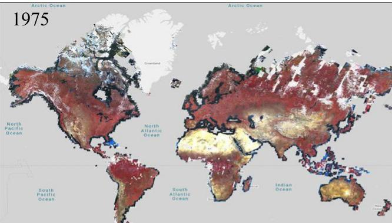
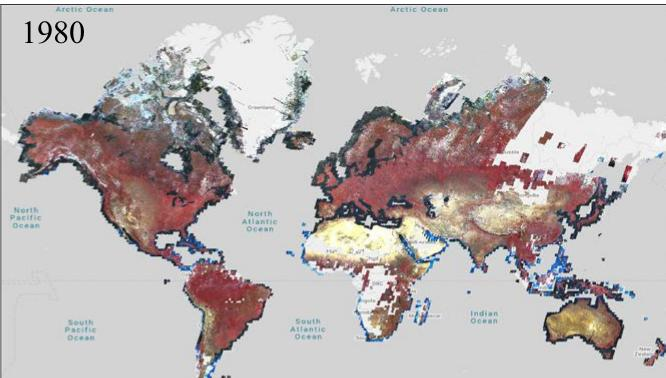
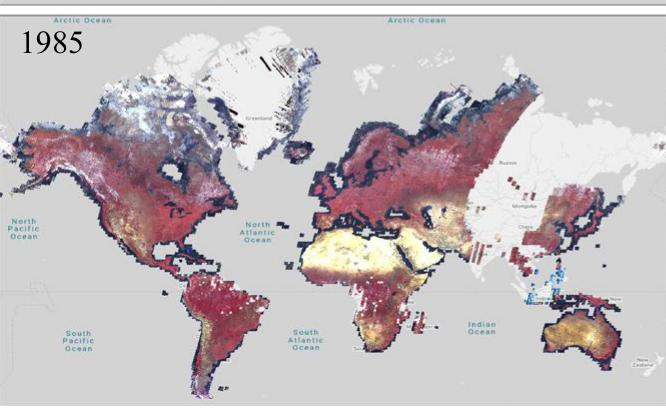
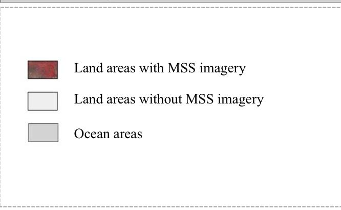
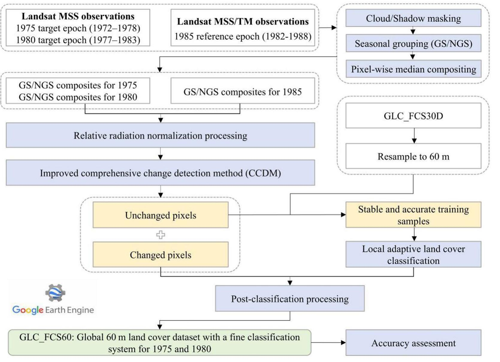
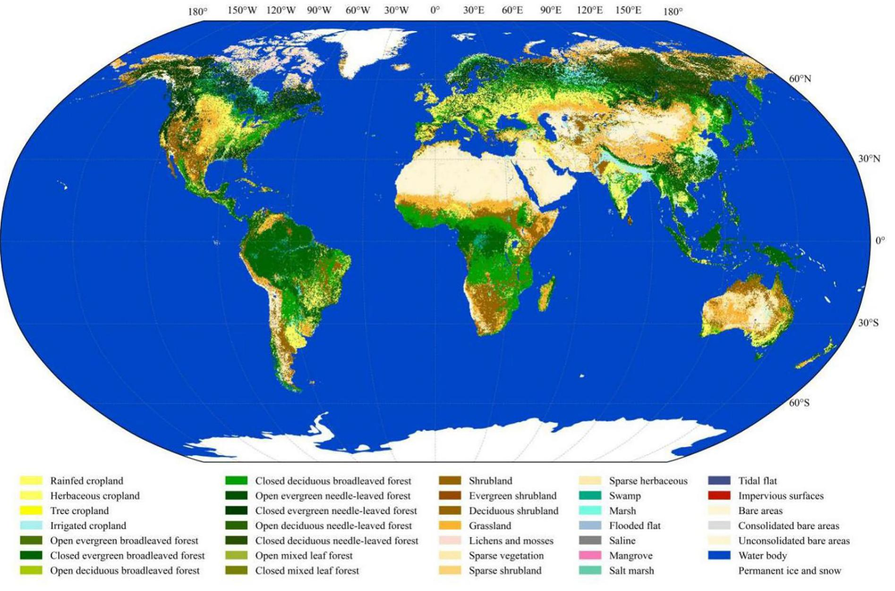
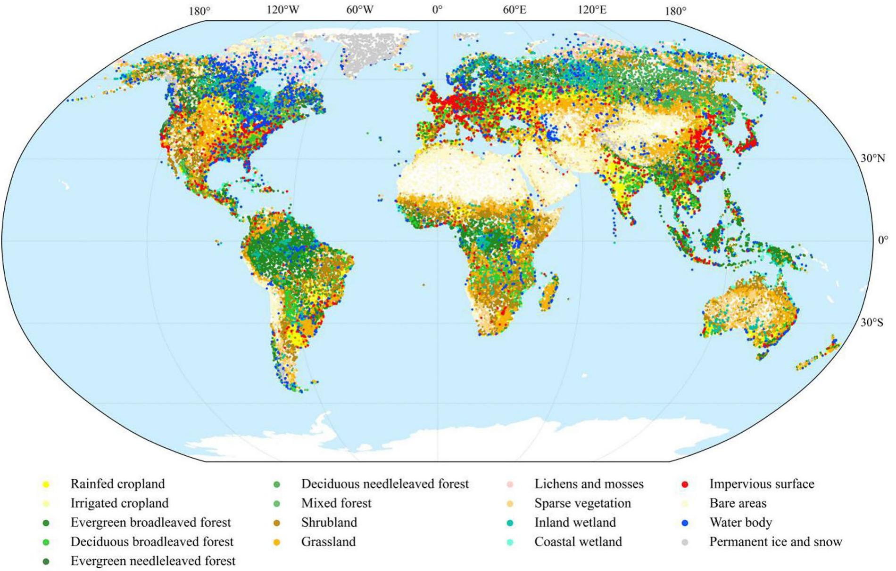
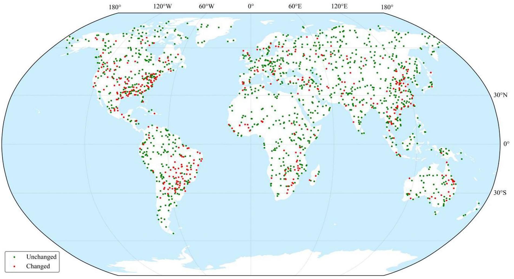

<PAGE>
www.nature.com/scientificdata
scientific data
Article in Press
OPEN
DATA DESCRIPTOR
A global 60 m land cover dataset with a fine classification system for 1975 and 1980 derived from Landsat MSS observations
Weitao Ai \( ^{1,2,3} \) , Xiao Zhang \( ^{2,3}\boxtimes \) , Chengfei Wang \( ^{2,3,4} \) , Fuguan Tang \( ^{1} \) , Tingting Zhao \( ^{2,3,5} \) , Wenhan Zhang \( ^{2,3,4} \)  & Liangyun Liu \( ^{2,6} \)
Long-term land cover datasets are essential for understanding human-environment interactions and global environmental change, yet global land cover information pre-1985 remains scarce because of limited availability of early satellite observations. Here, we present GLC_FC560, the first global 60 m land cover dataset with a fine classification system for 1975 and 1980, derived from Landsat Multispectral Scanner (MSS) observations. Specifically, an improved comprehensive change detection method with an adaptive thresholding strategy was applied to identify changed and unchanged land-cover pixels. The detected changed areas were then updated using high-confidence temporally stable training samples and locally adaptive classification models on the Google Earth Engine platform. The updated land cover maps were further optimized through post-processing to mitigate potential spurious changes, after which the GLC_FC560 time-series maps were generated. Finally, using 71,983 globally distributed validation samples, we assessed the accuracy of GLC_FC560, achieving overall accuracies of 80.13% and 80.08% for the 10 basic classes in 1975 and 1980, respectively, while a dedicated change/no-change validation achieved an overall accuracy of 78.61%. Therefore, GLC_FC560 fills a critical gap in global land cover observations prior to the mid-1980s and provides a valuable baseline for investigating long-term land cover dynamics from the mid-1970s to the present.
Background & Summary
Land cover data provide essential information for understanding terrestrial surface dynamics and supporting applications such as climate change assessment and ecosystem monitoring \( ^{1,2} \) . Since Landsat's first launch in 1972, remote sensing has enabled consistent and long-term observations of global land surface \( ^{3,4} \) . Benefiting from open-access remote sensing archives (e.g., the Landsat series) \( ^{5} \)  and the fast advances in cloud platforms including Google Earth Engine (GEE) \( ^{6} \) , numerous global land cover datasets have emerged in recent decades \( ^{4,7-12} \) . However, most of these products rely on Landsat Thematic Mapper (TM) and later sensors, which provide higher spectral and radiometric quality and denser temporal coverage than earlier satellite observations \( ^{13} \) . Consequently, existing datasets typically begin in the mid-1980s or later, leaving the pre-TM era—particularly the 1970s and early 1980s—largely unexplored. This gap is particularly important because previous studies have shown that global land-use change accelerated substantially between 1960 and 2004 \( ^{14} \) , making the early satellite era a critical period for investigating land cover dynamics. Despite its importance, global-scale land cover mapping for this period has remained challenging because of the limitations of early satellite observations, particularly Landsat Multispectral Scanner (MSS) imagery \( ^{15} \) . As a result, our understanding of long-term land cover dynamics remains incomplete.
\( ^{1} \) College of Geomatics, Xi'an University of Science and Technology, Xi'an, 710054, China.  \( ^{2} \) International Research Center of Big Data for Sustainable Development Goals, Beijing, 100094, China.  \( ^{3} \) Key Laboratory of Digital Earth Science, Aerospace Information Research Institute, Chinese Academy of Sciences, Beijing, 100094, China.  \( ^{4} \) University of Chinese Academy of Sciences, Beijing, 100049, China.  \( ^{5} \) School of Geography and Ocean Science, Nanjing University, Nanjing, 210023, China.  \( ^{6} \) School of Remote Sensing, Beijing Normal University, Beijing, 100875, China. ✉e-mail: zhangxiao@radi.ac.cn
SCIENTIFIC DATA | 1477. https://doi.org/10.1038/s41597-026-08368-9
Article in Press
<PAGE>
www.nature.com/scientificdata/
<table><tr><td>Dataset</td><td>Source</td><td>Spatial resolution</td><td>Temporal coverage</td><td>Access method</td></tr><tr><td>Landsat 1–5 MSS</td><td>USGS</td><td>60 m</td><td>1972–1988</td><td>https://developers.google.com/earth-engine/datasets/catalog/landsat-msh1i=zh-cn</td></tr><tr><td>Landsat 4–5 TM</td><td>USGS</td><td>30 m</td><td>1982–1988</td><td>https://developers.google.com/earth-engine/datasets/catalog/landsat?hl=zh-cn</td></tr><tr><td>GLC_FCS3D0</td><td>Zhang et al.</td><td>30 m</td><td>1985–2022</td><td>https://doi.org/10.5281/zenodo.15063683</td></tr><tr><td>ASTER GDEM</td><td>NASA/METI</td><td>30 m</td><td>2000–2013</td><td>https://doi.org/10.5067/ASTER/ASTGT.M03 (GEE public asset; projects/ast-io/open-datasets/ASTER/GDEM)</td></tr><tr><td>SRS_Val</td><td>Zhao et al.</td><td>30 m</td><td>2020</td><td>https://doi.org/10.5281/zenodo.7846900</td></tr></table>
Table 1. Third-party datasets used in this study.
Compared with later sensors (such as TAM and ETM + ), MSS data provide sparser temporal coverage and fewer spectral bands, increasing the difficulty of accurate land cover mapping and change monitoring. Previous studies have successfully applied MSS imagery to regional land cover mapping, often relying on limited observations and visual interpretation \( ^{15,16} \) . However, the substantial time, labor, and financial resources required by these approaches \( ^{17} \)  pose a major challenge for global-scale applications, where spatial consistency and classification accuracy should be maintained. Although the feasibility of using MSS data for local-scale mapping has been demonstrated, an automated framework capable of supporting consistent global-scale land cover mapping from MSS observations is still lacking. Therefore, there is a clear need to fully exploit MSS imagery, develop mapping approaches tailored to the characteristics of early satellite observations, and generate globally consistent land cover products for the pre-1985 period.
For monitoring global land cover changes, two main strategies are commonly adopted: “independent multi-temporal classification” and “change-detection-then-classification” \( ^{15} \) . The former classifies each epoch independently, often suffering from error accumulation and temporal inconsistency caused by classification noise and sensor differences \( ^{17,18} \) . In contrast, the latter identifies changed pixels and subsequently updates their labels using a reference map, which unchanged pixels directly inherit their labels from the reference map, thereby improving temporal consistency and reducing spurious changes \( ^{18,20,21} \) . Within this strategy, the selection of change detection algorithm is strongly influenced by the availability of satellite observations. When dense time-series observations are available (e.g., post-2000 Landsat or Sentinel archives), trajectory-fitting approaches like the Continuous Change Detection and Classification (CCDC) algorithm can effectively capture both gradual and abrupt changes by modeling temporal trajectories \( ^{22} \) . However, for the early satellite era, when only sparse observations are available, bi-temporal change detection methods are generally more appropriate. Given the limited and irregular temporal coverage of MSS imagery in the 1970s and early 1980s, a bi-temporal approach represents a practical and effective solution. Therefore, in this study, we adopt an improved bi-temporal Comprehensive Change Detection Method (CCDM) \( ^{1,3,23} \)  to identify changed pixels between 1975/1980 and 1985, leveraging the high-quality 1985 land cover map from GLC_FCS300D as a reference baseline.
To fill this gap, we generated GLC_FCS60, the first global land cover dataset with a fine classification system at 60 m resolution for 1975 and 1980, derived primarily from Landsat MSS imagery. The study comprised two main components: (1) constructing GLC_FCS60 using a change-detection-then-classification strategy based on the improved CCDM \( ^{15} \) ; and (2) conducting a comprehensive accuracy assessment of the products.
Methods
Remote sensing datasets. To generate GLC_FCS60, we used multi-source remote sensing imagery and ancillary data. The basic information, sources, and access methods of these datasets are summarized in Table 1, while detailed descriptions of the individual datasets are provided below.
Landsat MSs archives constituted one of the primary medium-resolution remote sensing data sources from the 1970s to the early 1980s. First launched in 1972 and providing imagery at \(60\mathrm{m}\) resolution, MSS served as a critical foundation for early land cover mapping efforts. Landsat MSS imagery includes four spectral bands: one green band, one red band, and a pair of near-infrared (NIR) bands. In this study, Landsat MSS imagery was used as the core dataset for generating GLC_FC560. Given the sparse temporal coverage and frequent data gaps in MSS imagery, all available observations within a \(\pm 3\)-year window centered on each base year were used to generate image composites. This strategy improves spatial coverage and reduces the influence of noise and anomalous observations. Figure 1 shows the global distribution of MSS false-color composites for 1975, 1980, and 1985 generated using the GEE platform. Despite the use of the multi-year compositing, some regions still lacked valid MSS observations during these periods. These areas accounted for \(19.88\%\) and \(25.29\%\) of the global mapped area in 1975 and 1980, respectively. In regions where MSS imagery was unavailable in 1985 (e.g., large parts of western China), Landsat TM imagery was used as a substitute reference dataset for change detection against the target-year composites. To maintain consistency with MSS imagery, the green, red, and NIR bands were selected from the TM imagery, and its \(30\mathrm{m}\) spatial resolution was subsequently down-sampled to \(60\mathrm{m}\). All MSS and TM imagery were obtained through the GEE platform.
The global land cover product GLC_FC530D \( ^{4} \) was used as an important auxiliary data source. This 30-m product provides global land cover maps from 1985 to 2022 with a fine classification system and high overall accuracy. Consistent with the classification system of GLC_FCS30D, the dataset serves two key roles in the mapping process. First, it is used to identify stable pixels that remain unchanged over extended periods, from which high-confidence training samples are automatically generated. Second, it provides prior information for constraining the change detection process by guiding the selection of adaptive thresholds, thereby ensuring that the magnitude of detected changes in earlier periods remains consistent with long-term land cover dynamics.
SCIENTIFIC DATA | _*****https://doi.org/10.1038/s41597-026-08368-9
Article in Press
<PAGE>
www.nature.com/scientificdata/

Fig. 1 Global distribution of Landsat MSS false-color composites for 1975, 1980, and 1985.
In this study, the post-processed GLC_FCS30D product \( ^{21} \) was used and can be freely accessed via the Zenodo repository (https://doi.org/10.5281/zenodo.1506383) \( ^{23} \).
The inclusion of topographic variables is important because land cover distribution is strongly influenced by topographic conditions, particularly in mountainous regions where elevation and slope affect vegetation types and land use patterns. In this study, ASTER Global Digital Elevation Model (GDEM) \( ^{24} \) data available through the GEE platform were used to derive topographic variables, including elevation, slope, and aspect.
The SRS_Val global validation dataset developed by Zhao et al. \( ^{27} \) was used for accuracy assessment. It was generated using a stratified random sampling strategy that accounted for landscape heterogeneity and population density, providing representative global spatial coverage. The dataset contains reference samples for 2020, which were further screened and interpreted in this study to derive reference samples for evaluating the 1975 and 1980 GLC_FC560 products. The SRS_Val dataset can be freely accessed via the Zenodo repository (https://doi.org/10.5281/zenodo.784690) \( ^{28} \).
Methodological framework. Figure 2 illustrates the overall workflow for generating GLC_FC560 from Landsat MS imagery. The framework consists of four main stages: (1) image compositing and normalization; (2) application of the improved bi-temporal CCDM to identify changed and unchanged pixels; (3) local adaptive classification of changed pixels; and (4) post-classification processing to generate the consistent land cover maps. For areas without valid MSS observations for a target year, where bi-temporal change detection could not be performed, the corresponding land-cover labels were directly inherited from GLC_FC530D_1985 under a no-change assumption.
Image compositing and normalization. Multi-year image compositing was performed to generate cloud-free images before bi-temporal change detection. Landsat MSS observations during the early satellite era were sparse and spatially incomplete, and were often contaminated by clouds and shadows, making single-date imagery insufficient for large-area mapping. The valid observations were therefore composited within a predefined multi-year temporal window to generate a high-quality image for each target epoch. Following previous studies \( ^{20} \) , composites were generated separately for the growing and non-growing seasons to support accurate change detection. In this study, all available Landsat MSS and TM scenes within the compositing window were first masked to remove clouds, shadows, and other invalid observations. The median-value compositing \( ^{29,30} \)  approach was then applied separately to the growing- and non-growing-season observations to generate the corresponding composite images. It is noteworthy that the growing season was defined as April–October (Northern Hemisphere) and October–April (Southern Hemisphere), while the remaining months were assigned to the non-growing season.
As subsequent change detection uses 1985 as the reference baseline, Landsat TM imagery was incorporated in regions where valid MSS observations were unavailable. Although MSS and TM are both Landsat sensors, they differ in spectral response and spatial resolution. Furthermore, radiometric inconsistencies may exist among MSS observations acquired by different Landsat missions under varying acquisition conditions. Therefore, we applied the Iteratively Reweighted Multivariate Alteration Detection (IR-MAD) \( ^{31} \) algorithm combined with geometric distance-based orthogonal regression \( ^{32} \) to normalize the 1975 and 1980 composites against the 1985 reference composites. Specifically, IR-MAD was first used to automatically identify pseudo-invariant pixels between the target and reference images. These invariant pixels were then used to construct orthogonal regression models, which transformed the target imagery to be radiometrically consistent with the reference imagery. In addition, when both the target-year and 1985 composites were derived from MSS imagery, all four MSS spectral bands were retained. When 1985 TM composites were used instead, only the green, red, and NIR-1
SCIENTIFIC DATA | _ nextfile | https://doi.org/10.1038/s41597-026-08368-9
Article in Press
<PAGE>
www.nature.com/scientificdata/

Fig. 2 Workflow for generating GLC_FC560, where GS and NGS denote growing season and non-growing season, respectively.
bands of MSS imagery were retained, whereas the NIR-2 band was excluded to maintain spectral consistency with TM observations.
Improved Comprehensive Chance Detection Method. To obtain reliable land-cover change information under sparse MSS observations, an improved CCDM \( ^{15} \) was applied by comparing the composited and normalized imagery from the target years (1975 and 1980) with the 1985 reference imagery. The method consists of three main components: (1) the Multi-Index Integrated Change Analysis (MIICA) model, (2) the Zone change detection model, and (3) an integration of MIICA and Zone outputs via an adaptive thresholding strategy.
The original CCDM integrates four spectral change indices: the differenced Normalized Difference Vegetation Index (dNDVI), differenced Normalized Burn Ratio (dNBR), Change Vector (CV), and Relative Change Vector Maximum (RCVMAX), to characterize land cover changes for both growing and non-growing seasons. Notably, since the MSS sensor lacks shortwave infrared (SWIR) bands, and some previous studies have shown that the Green Normalized Difference Vegetation Index (GNDVI) is sensitive to vegetation conditions and changes \( ^{33,34} \) , dGNDVI was used in place of dNBR for capturing vegetation-related changes. The four indices were calculated using Eqs. (1–4).
\[
d N D V I _ {t} = N D V I _ {\text { ref }, t} - N D V I _ {\text { tar }, t} \quad N D V I = \left(\rho_ {N I R} - \rho_ {R e d}\right) / \left(\rho_ {N I R} + \rho_ {R e d}\right) \tag {1}
\]
\[
d G N D V I _ {t} = G N D V I _ {\text {ref}, t} - G N D V I _ {\text {tar}, t}, \quad G N D V I = \left(\rho_ {N I R} - \rho_ {G r e e n}\right) / \left(\rho_ {N I R} + \rho_ {G r e e n}\right) \tag {2}
\]
\[
C V _ {t} = \sum_ {i} (\rho_ {\text {ref}, t, i} - \rho_ {\text {tar}, t, i}) ^ {2} \tag {3}
\]
\[
R C V M A X _ {t} = \sum_ {i} \left[ \left(\rho_ {\text {ref}, t, i} - \rho_ {\text {tar}, t, i}\right) / \max \left(\rho_ {\text {ref}, t, i}, \rho_ {\text {tar}, t, i}\right) ^ {2} \right] \tag {4}
\]
where ref and tar denote the reference year (1985) and the target year (1975 or 1980), respectively;  \( \rho_{reco,r} \) ,  \( \rho_{ref} \)  and  \( \rho_{NRR} \)  denote surface reflectance values; the subscript r indicates the season (growing or non-growing); and i is the serial number of corresponding spectral bands. The magnitude of each index reflects the intensity of land-cover change, with larger magnitudes indicating a higher likelihood of change. However, considering only change intensity may overlook valuable directional information. In particular, both dNDVI and dGNDVI can reveal the direction of land-cover change. A positive dNDVI value suggests a decrease in biomass, potentially indicating processes such as deforestation during this period. Building on previous work \( ^{31,32} \) , this directional
SCIENTIFIC DATA | _ https://doi.org/10.1038/s41597-026-08368-9
Article in Press
<PAGE>
www.nature.com/scientificdata/
information was further incorporated into the MIICA model to distinguish two change types: biomass increase (BI) and biomass decrease (BD), as defined in Eqs. (5–6).
\[
B I _ {t - M I I C A} = (C V > \mu_ {C V}) \cap (R C V M A X > \mu_ {R C V M A X} + n _ {1} \times \sigma_ {R C V M A X}) \cap (d N D V I <   \mu_ {N D V I} - n _ {2} \times \sigma_ {I N D V I}) \tag {5}
\]
\[
B D _ {t - M I I C A} = (C V > \mu_ {C V}) \cap (R C V M A X > \mu C V M A X + n _ {1} \times \sigma_ {R C V M A X}) \cap (d N D V I > \mu_ {A D V D I} + n _ {2} \times \sigma_ {A N D V I}) \tag {6}
\]
where \(\mu\) and \(\sigma\) denote the mean and standard deviation of the corresponding index, respectively; and \(n_1\) and \(n_2\) are parameters controlling the sensitivity of change detection in the MIICA model.
The change information extracted by MIICA is not fully comprehensive. Although both dGNDVI and dNDVI can indicate the magnitude and direction of land-cover change, dGNDVI is not fully utilized in the change detection process. Therefore, we introduced the Zone model, which jointly utilizes dGNDVI and dNDVI to compensate for potential emissions errors in MIICA \( ^{13,23} \) . Specifically, using these two indices, biomass changes are grouped into four categories: weak increase  \( (B_{c}) \) , weak decrease  \( (B_{c}) \) , strong increase  \( (B_{s-}) \) , and strong decrease  \( (B_{-}) \) . The corresponding value ranges are defined in Eq. (7).
\[
B _ {\mathrm{c}} \in (\mu - n _ {3} \times \sigma , \mu ]
\]
\[
B _ {-} \in (\mu , (\mu + n _ {3} \times \sigma)
\]
\[
B _ {+ -} \in (- \infty , \mu - n _ {3} \times \sigma ]
\]
\[
B _ {- -} \in [ \mu + n _ {3} \times \sigma , (+ \infty) \tag {7}
\]
where  \( n_{3} \)  is the parameter controlling the sensitivity of change detection in the Zone model. Furthermore, if the two indices exhibit consistent directions and both indicate strong increase or strong decrease, the pixel is classified as BI or BD, respectively, according to Eqs. (8–9).
\[
B I _ {t - Z o n e} = B _ {+, +} (d N D V I) \bigcap B _ {+, +} (d G N D V I) \tag {8}
\]
\[
B D _ {t - Z o n e} = B _ {- - } (d N D V I) \bigcap B _ {- - } (d G N D V I) \tag {9}
\]
As a complement to MILCA, the Zone model was integrated with it. The union of change outputs from the two models served as the change detection result of the improved CCDM. Furthermore, to ensure the reliability of detected changes, only pixels identified as changed in both growing-season and non-growing-season analyses were retained to form the preliminary change mask, namely the intersection of the two seasonal change maps.
It is worth noting that both MILCA and Zone are parameter-sensitive methods, and their associated parameters  \( (n_{t+1}, n_{t+2}, \text{and } n_{t}) \)  in Eqs. (5–7)) directly influence detection reliability. Conventional approaches rely on fixed empirical thresholds \( ^{20} \) , which are inherently subjective and may not adapt well to regional variations. Therefore, in this study we proposed using the GLC_FCS30D product as a priori knowledge to guide parameter determination. Specifically, as land cover change is closely associated with human activities, short-term changes are generally expected to be smaller than long-term ones. Based on this rationale, land cover changes from 1975/1980 to 1985 (Ch. 6) were assumed not to exceed those observed during 1985–2022 (Ch_late) \( ^{13} \) . The parameters in MIDL-A and Zone were then adaptively adjusted for each  \( 5^{\circ} \times 5^{\circ} \)  tile such that Ch_pre was as close as possible to, but did not exceed, the corresponding Ch_late derived from GLC_FCS300. The optimal values of  \( n_{1}, n_{2} \) , and  \( n_{3} \)  were selected for each tile, thereby generating final change masks that preserved directional information (BI/BD) for subsequent classification and analysis.
Local adaptive classification for changed pixels. Land cover mapping accuracy relies heavily on the quality of the training samples used \( ^{24,26} \) . While visual interpretation can provide highly accurate samples, this manual approach involves a heavy workload and long processing cycles, limiting its applicability to global-scale mapping \( ^{27} \) . To overcome this limitation, a globally distributed pool of high-confidence training samples was automatically generated using existing land cover products. Recent studies have demonstrated that spatiotemporal stable regions can provide reliable training samples \( ^{28,29} \) . Following this rationale, stable training samples were generated by intersecting two sets of pixels: (1) pixels identified as unchanged by the improved CDM between the target year (1975/1980) and 1985, and (2) pixels with consistent land cover labels in the 1985–2000 GLCC_FCS30D product (resampled to 60 m to match MSS imagery). The land cover labels of these unchanged pixels were directly derived from the GLC_FCS30D map in 1985. To ensure representativeness and reduce sample imbalance, the global land area was split into 961 geographical tiles of  \( 5^{\circ} \times 5^{\circ} \) , following the zoning scheme adopted in GLC_FCS30D \( ^{3} \) . Within each tile, training samples were allocated using an area-proportional strategy, with minimum and maximum sample sizes of 600 and 8,000 samples per land cover type, respectively, following previous studies \( ^{30-31} \) .
For the classification of changed pixels, a local adaptive modeling strategy was adopted, whereby a separate random forest classifier was constructed for each  \( 5^{\circ} \times 5^{\circ} \)  tile. This is because local adaptive models can more effectively capture regional complexity and heterogeneity and improve classification accuracy \( ^{58,63} \) . Additionally, random forest is an ensemble classifier that can effectively alleviate overfitting issues and exhibit low sensitivity to noisy training data \( ^{38,44,63} \) . As a result, a total of 21 multi-source features were fed into the random forest classification model. These features included 18 multi-temporal spectral variables derived from Landsat MSS composites, consisting of four spectral bands (green, red, NIR-1, and NIR-2) and two vegetation indices (NDVI
SCIENTIFIC DATA | _*****https://doi.org/10.1038/s41597-026-08368-9
Article in Press
<PAGE>
www.nature.com/scientificdata/
and GNDVI) calculated from the growing-season, non-growing-season, and annual-median composites. The remaining three topographic features—elevation, slope, and aspect—were obtained from the ASTER GDEM. Random forest classification was executed on the GEE platform using the eie.Classifier.smileRandomForest() function, with 100 decision trees \( ^{46} \) . The final land cover maps for 1975 and 1980 were generated by merging unchanged pixels, whose labels were directly inherited from the 1985 GLC_FCS30D map, with the newly classified changed pixels. For areas lacking MSS imagery coverage in 1975 and 1980, land cover types were assumed to remain unchanged from 1985.
Post-classification processing. To reduce spurious changes and improve the temporal consistency of the 1975 and 1980 land cover maps, two post-processing steps were applied. First, many previous studies treat impervious surface expansion as an irreversible process \( ^{43,44} \) ; accordingly, we also imposed an irreversibility constraint on impervious surfaces in this study. Transitions from non-impervious surfaces in 1975 or 1980 to impervious surfaces in 1985 were retained. In contrast, transitions from impervious surfaces in 1975 or 1980 to non-impervious surfaces in 1985 were treated as unrealistic and constrained during post-processing, with these cases reassigned to non-impervious surfaces. The same constraint was applied between 1975 and 1980 to ensure that impervious surface extent in 1975 did not exceed that in 1980.
Second, a modified version of the SKILL model (mSKILL) \( ^{3,48} \) was adopted to correct ecologically implausible land cover transitions by incorporating biomass change information from the improved CCDM outputs. Here, dNDVI was used as a proxy for the magnitude and direction of biomass change. The mSKILL model was designed to address two main types of inconsistencies: (1) Transitions that implied biomass increase (grassland to shrubland, shrubland to forest) but where the change detection indicated a decrease, and conversely, transitions implying biomass decreases (forest to shrubland, forest to grassland, shrubland to grassland) where the change detection indicated an increase. For such directional inconsistencies, the land cover type in 1975/1980 was reverted to the 1985 class (i.e., treated as unchanged). (2) Conversions from forest to grassland versus forest to shrubland, which required distinguishing the severity of biomass loss. For instance, if a pixel was classified as forest in 1985 but as grassland or shrubland in 1975/1980, the expected change direction was biomass decrease. The severity of biomass loss was then determined using the mean ( \( \mu \) ) and standard deviation ( \( \sigma \) ) of dNDVI: a dNDVI value exceeding \( \mu + 2\sigma \) indicated high-severity loss, and the pixel was labeled as grassland; a dNDVI value between \( \mu + \sigma \) and \( \mu + 2\sigma \) indicated moderate-severity loss, and the pixel was labeled as shrubland. This procedure effectively reduced spurious changes and enhanced the ecological plausibility of land cover transitions for the 1975 and 1980 maps.
Data Records
The 60 m global land cover datasets for 1975 and 1980 can be freely accessed through the Zenodo platform (https://doi.org/10.5281/zenodo.20688228) \( ^{16} \) . To facilitate efficient storage and data access, the data are organized into 961 geographical tiles of  \( 5^{\circ} \times 5^{\circ} \) . Each tile is provided as a GeoTIFF file containing two bands, where Band 1 and Band 2 correspond to land cover maps for 1975 and 1980, respectively. The tiles are named "GLC_FCS60_19751980_E****r and****r" and“#” denote the longitude and latitude coordinates of the upper-left corner of each tile (e.g., E120N30). The coordinate reference system (CRS) is WGS84 (EPSG:4326) in geographic coordinates. Land cover types are encoded using integer values consistent with the GLC_FCS30D classification system \( ^{5} \) , including 10 basic classes, 17 level-1 classes, and 35 fine classes. Figure 3 presents the global 80 m land cover map for 1975 based on the fine classification system. Details of the classification system are provided in Table S1 of the Supplementary information.
Technical Validation
Global validation dataset collection. Constructing a reliable validation dataset for land cover products in the early satellite era is particularly challenging, primarily due to the scarcity of contemporaneous reference data and the limited availability of satellite observations.
To evaluate the accuracy of GLC_FC560, the SRS_Val \( ^{6} \) reference samples were further screened and interpreted to derive reliable reference labels for 1975 and 1980. Considering the differences in spatial resolution (30 m versus 60 m) and temporal coverage between SRS, Val and GLC_FC560, three screening and interpretation steps were implemented to improve sample reliability. First, spatial homogeneity was assessed using the GLC_FC530D products \( ^{4} \). For each candidate point, a \( 3 \times 3 \) pixel window centered on the point was examined, and points with inconsistent land-cover labels within the window were discarded. Second, temporal consistency was evaluated using the multi-temporal GLC_FC530D products by retaining only points for which the land-cover labels of the corresponding pixels remained unchanged throughout 1985–2022. These two steps yielded 71,983 spatiotemporally homogeneous candidate samples. Finally, potential change areas were identified by comparing the 1975, 1980, and 1983 land-cover maps, and all candidate samples located within these areas were visually interpreted to assign reliable reference labels for 1975 and 1980. Additionally, 10% of the samples located in stable areas were randomly selected and manually checked to verify that no land-cover changes had occurred.
To ensure the confidence of each validation point, we utilized multiple-sourced auxiliary datasets to support the visual interpretation of the relevant sample points. These datasets included: (1) Landsat MSS false-color composites for 1975, 1980, and 1985; (2) NDVI time-series profiles derived from these composites; (3) ASTER GDEM-derived topographic variables; (4) historical climate data; (5) the geographic distribution characteristics of different land-cover subclasses; and (6) the prior land-cover labels associated with the validation samples. Importantly, the prior land-cover labels provided important contextual information for evaluating the plausibility of interpreted changes. The climatic and geographic distribution characteristics of different subclasses
SCIENTIFIC DATA | _*****|https://doi.org/10.1038/s41597-026-08368-9
Article in Press
<PAGE>
www.nature.com/scientificdata/

Fig. 3 Overview of the GLC_FC560 land cover map for 1975.
were also considered to assess whether an interpreted transition was environmentally plausible. For example, when distinguishing between coniferous and broadleaf forests, we considered multiple lines of evidence: coniferous forests are generally associated with colder climates and higher-latitude or high-elevation environments (e.g., boreal and alpine zones), whereas broadleaf forests are more commonly distributed in warmer and more humid climates within temperate, subtropical, and tropical regions. This climatic and geographic context was further integrated with seasonal NDVI trajectories—coniferous forests exhibit relatively stable NDVI throughout the year, while broadleaf forests show clear seasonal greening and senescence patterns—and cross-checked against topographic variables to reach a confident interpretation. When a transition was considered, it was not determined solely from the MSS spectral response, but was evaluated together with the regional climatic and geographic conditions, temporal observations, and the plausibility of the land-cover transition. In the absence of supporting evidence, such a transition would be considered less plausible. The visual interpretation process was conducted with the aid of the interpretation platform developed by Zhao et al. \( ^{30} \) . Overall, this procedure produced a validation dataset with improved reference-label reliability, whose spatial distribution broadly represented global land-cover patterns in 1975 (Fig. 4).
To quantify the ability of GLC_FC560 to detect land-cover changes, a dedicated change/no-change accuracy assessment was conducted. Potential change and no-change strata were first delineated by comparing the land-cover maps for 1975, 1980, and 1985. Candidate samples from the potential change strata were extracted from the validation dataset constructed in the previous step, while samples from the no-change strata were randomly selected near potential change areas to achieve an approximate 3:1 no-change-to-change sample ratio to mitigate class imbalance. All selected samples were then visually interpreted to determine whether actual land-cover change had occurred. This procedure yielded a change/no-change validation dataset comprising 1,664 samples, of which 411 were changed and 1,253 were unchanged (Fig. 5).
Accuracy assessment using the global validation dataset. Error matrices are widely used for assessing classification accuracy \( ^{10} \) . The associated accuracy metrics include producer's accuracy (PA), user's accuracy (UA), overall accuracy (OA) (Eq. (10)), and the Kappa coefficient.
\[
P. A _ {x} = \frac {N A K}{N \times N}
\]
\[
U. A _ {x} = \frac {N A K}{\sum N K}
\]
\[
O. A. = \frac {\sum_ {x = 1} ^ {n} N K k}{N} \tag {10}
\]
SCIENTIFIC DATA | _ https://doi.org/10.1038/s41597-026-08368-9
Article in Press
<PAGE>
www.nature.com/scientificdata/

Fig. 4 Global spatial distribution of validation samples covering 17 level-1 land cover classes in 1975.

Fig. 5 Global distribution of changed and unchanged validation samples for 1975–1985.
Where \( Nkk \) is the number of samples correctly classified into class \( k \); \( N \) is the total number of samples; \( \Sigma N \). \( k \) is the actual number of samples belonging to class \( k \); \( \Sigma Nk \). is the number of samples classified into class \( k \); and \( m \) is the number of land cover types.
Using the 71,983 validation samples, we evaluated the accuracy of GLC_FCS60 for 1975 at two classification levels: 10 basic classes and 17 level-1 classes. The error matrix for the 10 basic classes is presented in Table 2. For the 10 basic classes, the OA reached \(80.13\%\), with a Kappa coefficient of 0.76. Both PA and UA exceeded \(80\%\) for
SCIENTIFIC DATA | ***** ***** | https://doi.org/10.1038/s41597-026-08368-9
Article in Press
<PAGE>
www.nature.com/scientificdata/
<table><tr><td rowspan="2">Reference</td><td colspan="2">Map</td><td colspan="9">O.A. = 80.13% Kappa = 0.76</td></tr><tr><td>RCP</td><td>CPF</td><td>GFS</td><td>GRS</td><td>SHR</td><td>WET</td><td>WTR</td><td>TUD</td><td>IMP</td><td>BAL</td><td>PSI</td></tr><tr><td>CRP</td><td>10778</td><td>596</td><td>805</td><td>250</td><td>48</td><td>2</td><td>0</td><td>14</td><td>60</td><td>0</td><td>12553</td></tr><tr><td>FST</td><td>261</td><td>22361</td><td>239</td><td>350</td><td>456</td><td>15</td><td>2</td><td>14</td><td>31</td><td>0</td><td>23729</td></tr><tr><td>GRS</td><td>669</td><td>878</td><td>4278</td><td>873</td><td>151</td><td>6</td><td>50</td><td>7</td><td>834</td><td>1</td><td>7747</td></tr><tr><td>SHR</td><td>307</td><td>1348</td><td>665</td><td>3577</td><td>120</td><td>5</td><td>9</td><td>4</td><td>365</td><td>1</td><td>6401</td></tr><tr><td>WET</td><td>44</td><td>289</td><td>112</td><td>111</td><td>2432</td><td>168</td><td>27</td><td>6</td><td>143</td><td>1</td><td>3333</td></tr><tr><td>WTR</td><td>40</td><td>76</td><td>12</td><td>18</td><td>262</td><td>2083</td><td>9</td><td>0</td><td>21</td><td>1</td><td>2522</td></tr><tr><td>TUD</td><td>4</td><td>106</td><td>147</td><td>121</td><td>13</td><td>17</td><td>1895</td><td>2</td><td>467</td><td>5</td><td>2777</td></tr><tr><td>IMP</td><td>312</td><td>93</td><td>53</td><td>35</td><td>7</td><td>4</td><td>0</td><td>1870</td><td>25</td><td>0</td><td>2399</td></tr><tr><td>BAL</td><td>61</td><td>31</td><td>890</td><td>516</td><td>16</td><td>17</td><td>474</td><td>1</td><td>7324</td><td>46</td><td>9376</td></tr><tr><td>PSI</td><td>1</td><td>3</td><td>25</td><td>0</td><td>0</td><td>12</td><td>1</td><td>0</td><td>21</td><td>1083</td><td>1146</td></tr><tr><td>Total</td><td>12477</td><td>25781</td><td>7226</td><td>5851</td><td>3505</td><td>2329</td><td>2467</td><td>1918</td><td>9291</td><td>1138</td><td></td></tr><tr><td>U.A. (%)</td><td>86.38</td><td>86.73</td><td>59.20</td><td>61.13</td><td>69.39</td><td>89.44</td><td>76.81</td><td>97.50</td><td>78.83</td><td>95.17</td><td></td></tr></table>
Table 2. Error matrix derived from the 10 basic land cover classes.
<table><tr><td rowspan="2">Reference</td><td colspan="11">Map</td></tr><tr><td>RCP</td><td>ICP</td><td>EBF</td><td>DBF</td><td>ENF</td><td>DNF</td><td>MFT</td><td>SHR</td><td>GRS</td><td>LMS</td><td>SVG</td><td>HVL</td></tr><tr><td>RCP</td><td>8287</td><td>768</td><td>200</td><td>305</td><td>56</td><td>7</td><td>0</td><td>242</td><td>785</td><td>0</td><td>41</td><td>30</td></tr><tr><td>ICP</td><td>356</td><td>1367</td><td>18</td><td>9</td><td>1</td><td>0</td><td>0</td><td>8</td><td>20</td><td>0</td><td>2</td><td>11</td></tr><tr><td>EBF</td><td>86</td><td>25</td><td>7193</td><td>528</td><td>178</td><td>75</td><td>255</td><td>112</td><td>50</td><td>0</td><td>3</td><td>165</td></tr><tr><td>DBF</td><td>115</td><td>7</td><td>501</td><td>5214</td><td>332</td><td>141</td><td>203</td><td>117</td><td>116</td><td>0</td><td>2</td><td>109</td></tr><tr><td>ENF</td><td>19</td><td>3</td><td>129</td><td>133</td><td>4410</td><td>199</td><td>142</td><td>53</td><td>23</td><td>2</td><td>11</td><td>123</td></tr><tr><td>DNF</td><td>6</td><td>0</td><td>0</td><td>113</td><td>214</td><td>1369</td><td>51</td><td>62</td><td>48</td><td>0</td><td>10</td><td>27</td></tr><tr><td>MFT</td><td>0</td><td>0</td><td>21</td><td>88</td><td>109</td><td>280</td><td>485</td><td>6</td><td>2</td><td>0</td><td>0</td><td>14</td></tr><tr><td>SHR</td><td>295</td><td>12</td><td>268</td><td>666</td><td>286</td><td>123</td><td>5</td><td>3577</td><td>665</td><td>9</td><td>312</td><td>116</td></tr><tr><td>GRS</td><td>626</td><td>43</td><td>145</td><td>450</td><td>166</td><td>116</td><td>1</td><td>873</td><td>4278</td><td>50</td><td>676</td><td>146</td></tr><tr><td>LMS</td><td>2</td><td>2</td><td>1</td><td>20</td><td>29</td><td>55</td><td>1</td><td>121</td><td>147</td><td>1895</td><td>376</td><td>13</td></tr><tr><td>SVG</td><td>40</td><td>3</td><td>5</td><td>6</td><td>6</td><td>2</td><td>0</td><td>345</td><td>553</td><td>31</td><td>1936</td><td>5</td></tr><tr><td>IWL</td><td>30</td><td>12</td><td>78</td><td>51</td><td>115</td><td>33</td><td>1</td><td>105</td><td>110</td><td>25</td><td>106</td><td>1660</td></tr><tr><td>CWL</td><td>0</td><td>2</td><td>6</td><td>3</td><td>1</td><td>1</td><td>0</td><td>6</td><td>2</td><td>2</td><td>9</td><td>51</td></tr><tr><td>IMP</td><td>235</td><td>77</td><td>31</td><td>22</td><td>35</td><td>4</td><td>1</td><td>35</td><td>53</td><td>0</td><td>12</td><td>6</td></tr><tr><td>BAL</td><td>13</td><td>5</td><td>5</td><td>4</td><td>2</td><td>1</td><td>0</td><td>171</td><td>337</td><td>443</td><td>538</td><td>11</td></tr><tr><td>WTR</td><td>26</td><td>14</td><td>17</td><td>17</td><td>34</td><td>8</td><td>0</td><td>18</td><td>12</td><td>9</td><td>13</td><td>204</td></tr><tr><td>PSI</td><td>0</td><td>1</td><td>0</td><td>2</td><td>1</td><td>0</td><td>0</td><td>0</td><td>25</td><td>1</td><td>12</td><td>0</td></tr><tr><td>Total</td><td>10136</td><td>2341</td><td>8618</td><td>7631</td><td>5975</td><td>2414</td><td>1145</td><td>5851</td><td>7226</td><td>2467</td><td>4059</td><td>2691</td></tr><tr><td>U.A. (%)</td><td>81.76</td><td>58.39</td><td>83.46</td><td>68.33</td><td>73.81</td><td>56.71</td><td>42.36</td><td>61.13</td><td>59.20</td><td>76.81</td><td>47.70</td><td>61.69</td></tr></table>
<table><tr><td></td><td>Magnetar</td><td>RRL</td><td>PSR</td><td>Swift</td><td>LMT</td><td>BP</td><td>total</td><td>R.A.</td><td>PM.</td></tr><tr><td>CRP</td><td>1077</td><td>1076</td><td>1097</td><td>1057</td><td>85.97</td><td>85.97</td><td></td><td></td><td></td></tr><tr><td>FCP</td><td>86</td><td>86</td><td>86</td><td>87</td><td>84</td><td>84</td><td></td><td></td><td></td></tr><tr><td>FCP</td><td>86</td><td>86</td><td>87</td><td>86</td><td>84</td><td>84</td><td></td><td></td><td></td></tr><tr><td>FCP</td><td>86</td><td>86</td><td>87</td><td>86</td><td>84</td><td colspan="4"></td></tr><tr><td>FCP</td><td>86</td><td>86</td><td>87</td><td>86</td><td>84</td><td>84</td><td></td><td></td><td></td></tr><tr><td>MNT</td><td>86</td><td>86</td><td>87</td><td>86</td><td>84</td><td>84</td><td></td><td></td><td></td></tr><tr><td>MNT</td><td>86</td><td colspan="3"></td><td></td><td></td><td></td><td></td><td></td></tr><tr><td>MNT</td><td>86</td><td colspan="3"></td><td></td><td></td><td></td><td></td><td></td></tr><tr><td rowspan="2">MNT</td><td>86</td><td>86</td><td>87</td><td>86</td><td>84</td><td>84</td><td></td><td></td><td></td></tr><tr><td>86</td><td>86</td><td>87</td><td>86</td><td>84</td><td>84</td><td></td><td></td><td></td></tr><tr><td>MNT</td><td>86</td><td>87</td><td>86</td><td>87</td><td>84</td><td>84</td><td></td><td></td><td></td></tr><tr><td>MNT</td><td>86</td><td>87</td><td>86</td><td>87</td><td>84</td><td colspan="4"></td></tr><tr><td>MNT</td><td>86</td><td>87</td><td>86</td><td>87</td><td>84</td><td>84</td><td></td><td></td><td></td></tr><tr><td>Ours</td><td>86</td><td>87</td><td>86</td><td>87</td><td>84</td><td>84</td><td></td><td></td><td></td></tr><tr><td>Ours</td><td>86</td><td colspan="3"></td><td></td><td></td><td></td><td></td><td></td></tr><tr><td>Ours</td><td>86</td><td colspan="3"></td><td></td><td></td><td></td><td></td><td></td></tr><tr><td rowspan="2">MNT</td><td>86</td><td colspan="3"></td><td></td><td></td><td></td><td></td><td></td></tr><tr><td>86</td><td colspan="3"></td><td></td><td></td><td></td><td></td><td></td></tr><tr><td>MNT</td><td>86</td><td colspan="3"></td><td colspan="4"></td><td></td><td></td></tr><tr><td>MNT</td><td>86</td><td colspan="3"></td><td></td><td></td><td></td><td></td><td></td><td></td></tr><tr><td>MNT</td><td>86</td><td colspan="3"></td><td></td><td></td><td></td><td></td><td colspan="2"></td></tr><tr><td>MNT</td><td>86</td><td colspan="3"></td><td></td><td></td><td></td><td></td><td></td><td></td></tr><tr><td>MNT</td><td colspan="4"></td><td></td><td></td><td></td><td></td><td></td><td></td></tr><tr><td>MNT</td><td colspan="4"></td><td></td><td></td><td></td><td></td><td colspan="2"></td></tr><tr><td>MNT</td><td colspan="4"></td><td></td><td></td><td></td><td></td><td></td><td></td></tr><tr><td>MNT</td><td colspan="3"></td><td></td><td></td><td></td><td></td><td></td><td></td><td></td></tr><tr><td>MNT</td><td colspan="3"></td><td></td><td></td><td></td><td></td><td>-</td><td></td><td></td></tr><tr><td>MNT</td><td colspan="3"></td><td></td><td></td><td></td><td></td><td></td><td></td><td></td></tr><tr><td>-</td><td>-</td><td>-</td><td>-</td><td>-</td><td>-</td><td>-</td><td>-</td><td>-</td><td>-</td><td>-</td></tr><tr><td>-</td><td>-</td><td>-</td><td>-</td><td>-</td><td>-</td><td>-</td><td>-</td><td>-</td><td>-</td><td></td></tr><tr><td>-</td><td>-</td><td>-</td><td>-</td><td>-</td><td>-</td><td>-</td><td>-</td><td>-</td><td>- -</td><td></td></tr><tr><td>-</td><td>-</td><td>-</td><td>-</td><td>-</td><td>-</td><td>-</td><td>-</td><td>-</td><td>- 1</td><td></td></tr><tr><td>-</td><td>-</td><td>-</td><td>-</td><td>-</td><td>-</td><td>-</td><td>-</td><td>-</td><td>-1</td><td></td></tr><tr><td>-</td><td>-</td><td>-</td><td>-</td><td>-</td><td>-</td><td>-</td><td>-</td><td>-</td><td>1</td><td></td></tr><tr><td>-</td><td>-</td><td>-</td><td>-</td><td>-</td><td>-</td><td>-</td><td>-</td><td>-</td><td>2</td><td></td></tr><tr><td>-</td><td>-</td><td>-</td><td>-</td><td>-</td><td>-</td><td>-</td><td>-</td><td>-</td><td>3</td><td></td></tr><tr><td>-</td><td>-</td><td>-</td><td>-</td><td>-</td><td>-</td><td>-</td><td>-</td><td>-</td><td>4</td><td></td></tr><tr><td>-</td><td>-</td><td>-</td><td>-</td><td>-</td><td>-</td><td>-</td><td>-</td><td>-</td><td>5</td><td></td></tr><tr><td>-</td><td>-</td><td>-</td><td>-</td><td>-</td><td>-</td><td>-</td><td>-</td><td>-</td><td>6</td><td></td></tr><tr><td>-</td><td>-</td><td>-</td><td>-</td><td>-</td><td>-</td><td>-</td><td>-</td><td>-</td><td>7</td><td></td></tr><tr><td>-</td><td>-</td><td>-</td><td>-</td><td>-</td><td>-</td><td>-</td><td>-</td><td>-</td><td>8</td><td></td></tr><tr><td>-</td><td>-</td><td>-</td><td>-</td><td>-</td><td>-</td><td>-</td><td>-</td><td>-</td><td>9</td><td></td></tr><tr><td>-</td><td>-</td><td>-</td><td>-</td><td>-</td><td>-</td><td>-</td><td>-</td><td>-</td><td>10</td><td></td></tr><tr><td>-</td><td>-</td><td>-</td><td>-</td><td>-</td><td>-</td><td>-</td><td>-</td><td>-</td><td>11</td><td></td></tr><tr><td>-</td><td>-</td><td>-</td><td>-</td><td>-</td><td>-</td><td>-</td><td>-</td><td>-</td><td>12</td><td></td></tr><tr><td>-</td><td>-</td><td>-</td><td>-</td><td>-</td><td>-</td><td>-</td><td>-</td><td>-</td><td>13</td><td></td></tr><tr><td>-</td><td>-</td><td>-</td><td>-</td><td>-</td><td>-</td><td>-</td><td>-</td><td>-</td><td>14</td><td></td></tr><tr><td>-</td><td>-</td><td>-</td><td>-</td><td>-</td><td>-</td><td>-</td><td>-</td><td>-</td><td>15</td><td></td></tr><tr><td>-</td><td>-</td><td>-</td><td>-</td><td>-</td><td>-</td><td>-</td><td>-</td><td>-</td><td>16</td><td></td></tr><tr><td>-</td><td>-</td><td>-</td><td>-</td><td>-</td><td>-</td><td>-</td><td>-</td><td>-</td><td>17</td><td></td></tr><tr><td>-</td><td>-</td><td>-</td><td>-</td><td>-</td><td>-</td><td>-</td><td>-</td><td>-</td><td>18</td><td></td></tr><tr><td>-</td><td>-</td><td>-</td><td>-</td><td>-</td><td>-</td><td>-</td><td>-</td><td>-</td><td>19</td><td></td></tr><tr><td>-</td><td>-</td><td>-</td><td>-</td><td>-</td><td>-</td><td>-</td><td>-</td><td>-</td><td>20</td><td></td></tr><tr><td>-</td><td>-</td><td>-</td><td>-</td><td>-</td><td>-</td><td>-</td><td>-</td><td>-</td><td>21</td><td></td></tr><tr><td>-</td><td>-</td><td>-</td><td>-</td><td>-</td><td>-</td><td>-</td><td>-</td><td>-</td><td>22</td><td></td></tr><tr><td>-</td><td>-</td><td>-</td><td>-</td><td>-</td><td>-</td><td>-</td><td>-</td><td>-</td><td>23</td><td></td></tr><tr><td>-</td><td>-</td><td>-</td><td>-</td><td>-</td><td>-</td><td>-</td><td>-</td><td>-</td><td>24</td><td></td></tr><tr><td>-</td><td>-</td><td>-</td><td>-</td><td>-</td><td>-</td><td>-</td><td>-</td><td>-</td><td>25</td><td></td></tr><tr><td>-</td><td>-</td><td>-</td><td>-</td><td>-</td><td>-</td><td>-</td><td>-</td><td>-</td><td>26</td><td></td></tr><tr><td>-</td><td>-</td><td>-</td><td>-</td><td>-</td><td>-</td><td>-</td><td>-</td><td>-</td><td>27</td><td></td></tr><tr><td>-</td><td>-</td><td>-</td><td>-</td><td>-</td><td>-</td><td>-</td><td>-</td><td>-</td><td>28</td><td></td></tr><tr><td>-</td><td>-</td><td>-</td><td>-</td><td>-</td><td>-</td><td>-</td><td>-</td><td>-</td><td>29</td><td></td></tr><tr><td>-</td><td>-</td><td>-</td><td>-</td><td>-</td><td>-</td><td>-</td><td>-</td><td>-</td><td>30</td><td></td></tr><tr><td>-</td><td>-</td><td>-</td><td>-</td><td>-</td><td>-</td><td>-</td><td>-</td><td>-</td><td>31</td><td></td></tr><tr><td>-</td><td>-</td><td>-</td><td>-</td><td>-</td><td>-</td><td>-</td><td>-</td><td>-</td><td>32</td><td></td></tr><tr><td>-</td><td>-</td><td>-</td><td>-</td><td>-</td><td>-</td><td>-</td><td>-</td><td>-</td><td>33</td><td></td></tr><tr><td>-</td><td>-</td><td>-</td><td>-</td><td>-</td><td>-</td><td>-</td><td>-</td><td>-</td><td>34</td><td></td></tr><tr><td>-</td><td>-</td><td>-</td><td>-</td><td>-</td><td>-</td><td>-</td><td>-</td><td>-</td><td>35</td><td></td></tr><tr><td>-</td><td>-</td><td>-</td><td>-</td><td>-</td><td>-</td><td>-</td><td>-</td><td>-</td><td>36</td><td></td></tr><tr><td>-</td><td>-</td><td>-</td><td>-</td><td>-</td><td>-</td><td>-</td><td>-</td><td>-</td><td>37</td><td></td></tr><tr><td>-</td><td>-</td><td>-</td><td>-</td><td>-</td><td>-</td><td>-</td><td>-</td><td>-</td><td>38</td><td></td></tr><tr><td>-</td><td>-</td><td>-</td><td>-</td><td>-</td><td>-</td><td>-</td><td>-</td><td>-</td><td>39</td><td></td></tr><tr><td>-</td><td>-</td><td>-</td><td>-</td><td>-</td><td>-</td><td>-</td><td>-</td><td>-</td><td>40</td><td></td></tr><tr><td>-</td><td>-</td><td>-</td><td>-</td><td>-</td><td>-</td><td>-</td><td>-</td><td>-</td><td>41</td><td></td></tr><tr><td>-</td><td>-</td><td>-</td><td>-</td><td>-</td><td>-</td><td>-</td><td>-</td><td>-</td><td>42</td><td></td></tr><tr><td>-</td><td>-</td><td>-</td><td>-</td><td>-</td><td>-</td><td>-</td><td>-</td><td>-</td><td>43</td><td></td></tr><tr><td>-</td><td>-</td><td>-</td><td>-</td><td>-</td><td>-</td><td>-</td><td>-</td><td>-</td><td>44</td><td></td></tr><tr><td>-</td><td>-</td><td>-</td><td>-</td><td>-</td><td>-</td><td>-</td><td>-</td><td>-</td><td>45</td><td></td></tr><tr><td>-</td><td>-</td><td>-</td><td>-</td><td>-</td><td>-</td><td>-</td><td>-</td><td>-</td><td>46</td><td></td></tr><tr><td>-</td><td>-</td><td>-</td><td>-</td><td>-</td><td>-</td><td>-</td><td>-</td><td>-</td><td>47</td><td></td></tr><tr><td>-</td><td>-</td><td>-</td><td>-</td><td>-</td><td>-</td><td>-</td><td>-</td><td>-</td><td>48</td><td></td></tr><tr><td>-</td><td>-</td><td>-</td><td>-</td><td>-</td><td>-</td><td>-</td><td>-</td><td>-</td><td>49</td><td></td></tr><tr><td>-</td><td>-</td><td>-</td><td>-</td><td>-</td><td>-</td><td>-</td><td>-</td><td>-</td><td>50</td><td></td></tr><tr><td>-</td><td>-</td><td>-</td><td>-</td><td>-</td><td>-</td><td>-</td><td>-</td><td>-</td><td>51</td><td></td></tr><tr><td>-</td><td>-</td><td>-</td><td>-</td><td>-</td><td>-</td><td>-</td><td>-</td><td>-</td><td>52</td><td></td></tr><tr><td>-</td><td>-</td><td>-</td><td>-</td><td>-</td><td>-</td><td>-</td><td>-</td><td>-</td><td>53</td><td></td></tr><tr><td>-</td><td>-</td><td>-</td><td>-</td><td>-</td><td>-</td><td>-</td><td>-</td><td>-</td><td>54</td><td></td></tr><tr><td>-</td><td>-</td><td>-</td><td>-</td><td>-</td><td>-</td><td>-</td><td>-</td><td>-</td><td>55</td><td></td></tr><tr><td>-</td><td>-</td><td>-</td><td>-</td><td>-</td><td>-</td><td>-</td><td>-</td><td>-</td><td>56</td><td></td></tr><tr><td>-</td><td>-</td><td>-</td><td>-</td><td>-</td><td>-</td><td>-</td><td>-</td><td>-</td><td>57</td><td></td></tr><tr><td>-</td><td>-</td><td>-</td><td>-</td><td>-</td><td>-</td><td>-</td><td>-</td><td>-</td><td>58</td><td></td></tr><tr><td>-</td><td>-</td><td>-</td><td>-</td><td>-</td><td>-</td><td>-</td><td>-</td><td>-</td><td>59</td><td></td></tr><tr><td>-</td><td>-</td><td>-</td><td>-</td><td>-</td><td>-</td><td>-</td><td>-</td><td>-</td><td>60</td><td></td></tr><tr><td>-</td><td>-</td><td>-</td><td>-</td><td>-</td><td>-</td><td>-</td><td>-</td><td>-</td><td>61</td><td></td></tr><tr><td>-</td><td>-</td><td>-</td><td>-</td><td>-</td><td>-</td><td>-</td><td>-</td><td>-</td><td>62</td><td></td></tr><tr><td>-</td><td>-</td><td>-</td><td>-</td><td>-</td><td>-</td><td>-</td><td>-</td><td>-</td><td>63</td><td></td></tr><tr><td>-</td><td>-</td><td>-</td><td>-</td><td>-</td><td>-</td><td>-</td><td>-</td><td>-</td><td>64</td><td></td></tr><tr><td>-</td><td>-</td><td>-</td><td>-</td><td>-</td><td>-</td><td>-</td><td>-</td><td>-</td><td>65</td><td></td></tr><tr><td>-</td><td>-</td><td>-</td><td>-</td><td>-</td><td>-</td><td>-</td><td>-</td><td>-</td><td>66</td><td></td></tr><tr><td>-</td><td>-</td><td>-</td><td>-</td><td>-</td><td>-</td><td>-</td><td>-</td><td>-</td><td>67</td><td></td></tr><tr><td>-</td><td>-</td><td>-</td><td>-</td><td>-</td><td>-</td><td>-</td><td>-</td><td>-</td><td>68</td><td></td></tr><tr><td>-</td><td>-</td><td>-</td><td>-</td><td>-</td><td>-</td><td>-</td><td>-</td><td>-</td><td>69</td><td></td></tr><tr><td>-</td><td>-</td><td>-</td><td>-</td><td>-</td><td>-</td><td>-</td><td>-</td><td>-</td><td>70</td><td></td></tr><tr><td>-</td><td>-</td><td>-</td><td>-</td><td>-</td><td>-</td><td>-</td><td>-</td><td>-</td><td>71</td><td></td></tr><tr><td>-</td><td>-</td><td>-</td><td>-</td><td>-</td><td>-</td><td>-</td><td>-</td><td>-</td><td>72</td><td></td></tr><tr><td>-</td><td>-</td><td>-</td><td>-</td><td>-</td><td>-</td><td>-</td><td>-</td><td>-</td><td>73</td><td></td></tr><tr><td>-</td><td>-</td><td>-</td><td>-</td><td>-</td><td>-</td><td>-</td><td>-</td><td>-</td><td>74</td><td></td></tr><tr><td>-</td><td>-</td><td>-</td><td>-</td><td>-</td><td>-</td><td>-</td><td>-</td><td>-</td><td>75</td><td></td></tr><tr><td>-</td><td>-</td><td>-</td><td>-</td><td>-</td><td>-</td><td>-</td><td>-</td><td>-</td><td>76</td><td></td></tr><tr><td>-</td><td>-</td><td>-</td><td>-</td><td>-</td><td>-</td><td>-</td><td>-</td><td>-</td><td>77</td><td></td></tr><tr><td>-</td><td>-</td><td>-</td><td>-</td><td>-</td><td>-</td><td>-</td><td>-</td><td>-</td><td>78</td><td></td></tr><tr><td>-</td><td>-</td><td>-</td><td>-</td><td>-</td><td>-</td><td>-</td><td>-</td><td>-</td><td>79</td><td></td></tr><tr><td>-</td><td>-</td><td>-</td><td>-</td><td>-</td><td>-</td><td>-</td><td>-</td><td>-</td><td>80</td><td></td></tr><tr><td>-</td><td>-</td><td>-</td><td>-</td><td>-</td><td>-</td><td>-</td><td>-</td><td>-</td><td>81</td><td></td></tr><tr><td>-</td><td>-</td><td>-</td><td>-</td><td>-</td><td>-</td><td>-</td><td>-</td><td>-</td><td>82</td><td></td></tr><tr><td>-</td><td>-</td><td>-</td><td>-</td><td>-</td><td>-</td><td>-</td><td>-</td><td>-</td><td>83</td><td></td></tr><tr><td>-</td><td>-</td><td>-</td><td>-</td><td>-</td><td>-</td><td>-</td><td>-</td><td>-</td><td>84</td><td></td></tr><tr><td>-</td><td>-</td><td>-</td><td>-</td><td>-</td><td>-</td><td>-</td><td>-</td><td>-</td><td>85</td><td></td></tr><tr><td>-</td><td>-</td><td>-</td><td>-</td><td>-</td><td>-</td><td>-</td><td>-</td><td>-</td><td>86</td><td></td></tr><tr><td>-</td><td>-</td><td>-</td><td>-</td><td>-</td><td>-</td><td>-</td><td>-</td><td>-</td><td>87</td><td></td></tr><tr><td>-</td><td>-</td><td>-</td><td>-</td><td>-</td><td>-</td><td>-</td><td>-</td><td>-</td><td>88</td><td></td></tr><tr><td>-</td><td>-</td><td>-</td><td>-</td><td>-</td><td>-</td><td>-</td><td>-</td><td>-</td><td>89</td><td></td></tr><tr><td>-</td><td>-</td><td>-</td><td>-</td><td>-</td><td>-</td><td>-</td><td>-</td><td>-</td><td>90</td><td></td></tr><tr><td>-</td><td>-</td><td>-</td><td>-</td><td>-</td><td>-</td><td>-</td><td>-</td><td>-</td><td>91</td><td></td></tr><tr><td>-</td><td>-</td><td>-</td><td>-</td><td>-</td><td>-</td><td>-</td><td>-</td><td>-</td><td>92</td><td></td></tr><tr><td>-</td><td>-</td><td>-</td><td>-</td><td>-</td><td>-</td><td>-</td><td>-</td><td>-</td><td>93</td><td></td></tr><tr><td>-</td><td>-</td><td>-</td><td>-</td><td>-</td><td>-</td><td>-</td><td>-</td><td>-</td><td>94</td><td></td></tr><tr><td>-</td><td>-</td><td>-</td><td>-</td><td>-</td><td>-</td><td>-</td><td>-</td><td>-</td><td>95</td><td></td></tr><tr><td>-</td><td>-</td><td>-</td><td>-</td><td>-</td><td>-</td><td>-</td><td>-</td><td>-</td><td>96</td><td></td></tr><tr><td>-</td><td>-</td><td>-</td><td>-</td><td>-</td><td>-</td><td>-</td><td>-</td><td>-</td><td>97</td><td></td></tr><tr><td>-</td><td>-</td><td>-</td><td>-</td><td>-</td><td>-</td><td>-</td><td>-</td><td>-</td><td>98</td><td></td></tr><tr><td>-</td><td>-</td><td>-</td><td>-</td><td>-</td><td>-</td><td>-</td><td>-</td><td>-</td><td>99</td><td></td></tr><tr><td>-</td><td>-</td><td>-</td><td>-</td><td>-</td><td>-</td><td>-</td><td>-</td><td>-</td><td>100</td><td></td></tr><tr><td>-</td><td>-</td><td>-</td><td>-</td><td>-</td><td>-</td><td>-</td><td>-</td><td>-</td><td>101</td><td></td></tr><tr><td>-</td><td>-</td><td>-</td><td>-</td><td>-</td><td>-</td><td>-</td><td>-</td><td>-</td><td>102</td><td></td></tr><tr><td>-</td><td>-</td><td>-</td><td>-</td><td>-</td><td>-</td><td>-</td><td>-</td><td>-</td><td>103</td><td></td></tr><tr><td>-</td><td>-</td><td>-</td><td>-</td><td>-</td><td>-</td><td>-</td><td>-</td><td>-</td><td>104</td><td></td></tr><tr><td>-</td><td>-</td><td>-</td><td>-</td><td>-</td><td>-</td><td>-</td><td>-</td><td>-</td><td>105</td><td></td></tr><tr><td>-</td><td>-</td><td>-</td><td>-</td><td>-</td><td>-</td><td>-</td><td>-</td><td>-</td><td>106</td><td></td></tr><tr><td>-</td><td>-</td><td>-</td><td>-</td><td>-</td><td>-</td><td>-</td><td>-</td><td>-</td><td>107</td><td></td></tr><tr><td>-</td><td>-</td><td>-</td><td>-</td><td>-</td><td>-</td><td>-</td><td>-</td><td>-</td><td>108</td><td></td></tr><tr><td>-</td><td>-</td><td>-</td><td>-</td><td>-</td><td>-</td><td>-</td><td>-</td><td>-</td><td>109</td><td></td></tr><tr><td>-</td><td>-</td><td>-</td><td>-</td><td>-</td><td>-</td><td>-</td><td>-</td><td>-</td><td>110</td><td></td></tr><tr><td>-</td><td>-</td><td>-</td><td>-</td><td>-</td><td>-</td><td>-</td><td>-</td><td>-</td><td>111</td><td></td></tr><tr><td>-</td><td>-</td><td>-</td><td>-</td><td>-</td><td>-</td><td>-</td><td>-</td><td>-</td><td>112</td><td></td></tr><tr><td>-</td><td>-</td><td>-</td><td>-</td><td>-</td><td>-</td><td>-</td><td>-</td><td>-</td><td>113</td><td></td></tr><tr><td>-</td><td>-</td><td>-</td><td>-</td><td>-</td><td>-</td><td>-</td><td>-</td><td>-</td><td>114</td><td></td></tr><tr><td>-</td><td>-</td><td>-</td><td>-</td><td>-</td><td>-</td><td>-</td><td>-</td><td>-</td><td>115</td><td></td></tr><tr><td>-</td><td>-</td><td>-</td><td>-</td><td>-</td><td>-</td><td>-</td><td>-</td><td>-</td><td>116</td><td></td></tr><tr><td>-</td><td>-</td><td>-</td><td>-</td><td>-</td><td>-</td><td>-</td><td>-</td><td>-</td><td>117</td><td></td></tr><tr><td>-</td><td>-</td><td>-</td><td>-</td><td>-</td><td>-</td><td>-</td><td>-</td><td>-</td><td>118</td><td></td></tr><tr><td>-</td><td>-</td><td>-</td><td>-</td><td>-</td><td>-</td><td>-</td><td>-</td><td>-</td><td>119</td><td></td></tr><tr><td>-</td><td>-</td><td>-</td><td>-</td><td>-</td><td>-</td><td>-</td><td>-</td><td>-</td><td>120</td><td></td></tr><tr><td>-</td><td>-</td><td>-</td><td>-</td><td>-</td><td>-</td><td>-</td><td>-</td><td>-</td><td>121</td><td></td></tr><tr><td>-</td><td>-</td><td>-</td><td>-</td><td>-</td><td>-</td><td>-</td><td>-</td><td>-</td><td>122</td><td></td></tr><tr><td>-</td><td>-</td><td>-</td><td>-</td><td>-</td><td>-</td><td>-</td><td>-</td><td>-</td><td>123</td><td></td></tr><tr><td>-</td><td>-</td><td>-</td><td>-</td><td>-</td><td>-</td><td>-</td><td>-</td><td>-</td><td>124</td><td></td></tr><tr><td>-</td><td>-</td><td>-</td><td>-</td><td>-</td><td>-</td><td>-</td><td>-</td><td>-</td><td>125</td><td></td></tr><tr><td>-</td><td>-</td><td>-</td><td>-</td><td>-</td><td>-</td><td>-</td><td>-</td><td>-</td><td>126</td><td></td></tr><tr><td>-</td><td>-</td><td>-</td><td>-</td><td>-</td><td>-</td><td>-</td><td>-</td><td>-</td><td>127</td><td></td></tr><tr><td>-</td><td>-</td><td>-</td><td>-</td><td>-</td><td>-</td><td>-</td><td>-</td><td>-</td><td>128</td><td></td></tr><tr><td>-</td><td>-</td><td>-</td><td>-</td><td>-</td><td>-</td><td>-</td><td>-</td><td>-</td><td>129</td><td></td></tr><tr><td>-</td><td>-</td><td>-</td><td>-</td><td>-</td><td>-</td><td>-</td><td>-</td><td>-</td><td>130</td><td></td></tr><tr><td>-</td><td>-</td><td>-</td><td>-</td><td>-</td><td>-</td><td>-</td><td>-</td><td>-</td><td>131</td><td></td></tr><tr><td>-</td><td>-</td><td>-</td><td>-</td><td>-</td><td>-</td><td>-</td><td>-</td><td>-</td><td>132</td><td></td></tr><tr><td>-</td><td>-</td><td>-</td><td>-</td><td>-</td><td>-</td><td>-</td><td>-</td><td>-</td><td>133</td><td></td></tr><tr><td>-</td><td>-</td><td>-</td><td>-</td><td>-</td><td>-</td><td>-</td><td>-</td><td>-</td><td>134</td><td></td></tr><tr><td>-</td><td>-</td><td>-</td><td>-</td><td>-</td><td>-</td><td>-</td><td>-</td><td>-</td><td>135</td><td></td></tr><tr><td>-</td><td>-</td><td>-</td><td>-</td><td>-</td><td>-</td><td>-</td><td>-</td><td>-</td><td>136</td><td></td></tr><tr><td>-</td><td>-</td><td>-</td><td>-</td><td>-</td><td>-</td><td>-</td><td>-</td><td>-</td><td>137</td><td></td></tr><tr><td>-</td><td>-</td><td>-</td><td>-</td><td>-</td><td>-</td><td>-</td><td>-</td><td>-</td><td>138</td><td></td></tr><tr><td>-</td><td>-</td><td>-</td><td>-</td><td>-</td><td>-</td><td>-</td><td>-</td><td>-</td><td>139</td><td></td></tr><tr><td>-</td><td>-</td><td>-</td><td>-</td><td>-</td><td>-</td><td>-</td><td>-</td><td>-</td><td>140</td><td></td></tr><tr><td>-</td><td>-</td><td>-</td><td>-</td><td>-</td><td>-</td><td>-</td><td>-</td><td>-</td><td>141</td><td></td></tr><tr><td>-</td><td>-</td><td>-</td><td>-</td><td>-</td><td>-</td><td>-</td><td>-</td><td>-</td><td>142</td><td></td></tr><tr><td>-</td><td>-</td><td>-</td><td>-</td><td>-</td><td>-</td><td>-</td><td>-</td><td>-</td><td>143</td><td></td></tr><tr><td>-</td><td>-</td><td>-</td><td>-</td><td>-</td><td>-</td><td>-</td><td>-</td><td>-</td><td>144</td><td></td></tr><tr><td>-</td><td>-</td><td>-</td><td>-</td><td>-</td><td>-</td><td>-</td><td>-</td><td>-</td><td>145</td><td></td></tr><tr><td>-</td><td>-</td><td>-</td><td>-</td><td>-</td><td>-</td><td>-</td><td>-</td><td>-</td><td>146</td><td></td></tr><tr><td>-</td><td>-</td><td>-</td><td>-</td><td>-</td><td>-</td><td>-</td><td>-</td><td>-</td><td>147</td><td></td></tr><tr><td>-</td><td>-</td><td>-</td><td>-</td><td>-</td><td>-</td><td>-</td><td>-</td><td>-</td><td>148</td><td></td></tr><tr><td>-</td><td>-</td><td>-</td><td>-</td><td>-</td><td>-</td><td>-</td><td>-</td><td>-</td><td>149</td><td></td></tr><tr><td>-</td><td>-</td><td>-</td><td>-</td><td>-</td><td>-</td><td>-</td><td>-</td><td>-</td><td>150</td><td></td></tr><tr><td>-</td><td>-</td><td>-</td><td>-</td><td>-</td><td>-</td><td>-</td><td>-</td><td>-</td><td>151</td><td></td></tr><tr><td>-</td><td>-</td><td>-</td><td>-</td><td>-</td><td>-</td><td>-</td><td>-</td><td>-</td><td>152</td><td></td></tr><tr><td>-</td><td>-</td><td>-</td><td>-</td><td>-</td><td>-</td><td>-</td><td>-</td><td>-</td><td>153</td><td></td></tr><tr><td>-</td><td>-</td><td>-</td><td>-</td><td>-</td><td>-</td><td>-</td><td>-</td><td>-</td><td>154</td><td></td></tr><tr><td>-</td><td>-</td><td>-</td><td>-</td><td>-</td><td>-</td><td>-</td><td>-</td><td>-</td><td>155</td><td></td></tr><tr><td>-</td><td>-</td><td>-</td><td>-</td><td>-</td><td>-</td><td>-</td><td>-</td><td>-</td><td>156</td><td></td></tr><tr><td>-</td><td>-</td><td>-</td><td>-</td><td>-</td><td>-</td><td>-</td><td>-</td><td>-</td><td>157</td><td></td></tr><tr><td>-</td><td>-</td><td>-</td><td>-</td><td>-</td><td>-</td><td>-</td><td>-</td><td>-</td><td>158</td><td></td></tr><tr><td>-</td><td>-</td><td>-</td><td>-</td><td>-</td><td>-</td><td>-</td><td>-</td><td>-</td><td>159</td><td></td></tr><tr><td>-</td><td>-</td><td>-</td><td>-</td><td>-</td><td>-</td><td>-</td><td>-</td><td>-</td><td>160</td><td></td></tr><tr><td>-</td><td>-</td><td>-</td><td>-</td><td>-</td><td>-</td><td>-</td><td>-</td><td>-</td><td>161</td><td></td></tr><tr><td>-</td><td>-</td><td>-</td><td>-</td><td>-</td><td>-</td><td>-</td><td>-</td><td>-</td><td>162</td><td></td></tr><tr><td>-</td><td>-</td><td>-</td><td>-</td><td>-</td><td>-</td><td>-</td><td>-</td><td>-</td><td>163</td><td></td></tr><tr><td>-</td><td>-</td><td>-</td><td>-</td><td>-</td><td>-</td><td>-</td><td>-</td><td>-</td><td>164</td><td></td></tr><tr><td>-</td><td>-</td><td>-</td><td>-</td><td>-</td><td>-</td><td>-</td><td>-</td><td>-</td><td>165</td><td></td></tr><tr><td>-</td><td>-</td><td>-</td><td>-</td><td>-</td><td>-</td><td>-</td><td>-</td><td>-</td><td>166</td><td></td></tr><tr><td>-</td><td>-</td><td>-</td><td>-</td><td>-</td><td>-</td><td>-</td><td>-</td><td>-</td><td>167</td><td></td></tr><tr><td>-</td><td>-</td><td>-</td><td>-</td><td>-</td><td>-</td><td>-</td><td>-</td><td>-</td><td>168</td><td></td></tr><tr><td>-</td><td>-</td><td>-</td><td>-</td><td>-</td><td>-</td><td>-</td><td>-</td><td>-</td><td>169</td><td></td></tr><tr><td>-</td><td>-</td><td>-</td><td>-</td><td>-</td><td>-</td><td>-</td><td>-</td><td>-</td><td>170</td><td></td></tr><tr><td>-</td><td>-</td><td>-</td><td>-</td><td>-</td><td>-</td><td>-</td><td>-</td><td>-</td><td>171</td><td></td></tr><tr><td>-</td><td>-</td><td>-</td><td>-</td><td>-</td><td>-</td><td>-</td><td>-</td><td>-</td><td>172</td><td></td></tr><tr><td>-</td><td>-</td><td>-</td><td>-</td><td>-</td><td>-</td><td>-</td><td>-</td><td>-</td><td>173</td><td></td></tr><tr><td>-</td><td>-</td><td>-</td><td>-</td><td>-</td><td>-</td><td>-</td><td>-</td><td>-</td><td>174</td><td></td></tr><tr><td>-</td><td>-</td><td>-</td><td>-</td><td>-</td><td>-</td><td>-</td><td>-</td><td>-</td><td>175</td><td></td></tr><tr><td>-</td><td>-</td><td>-</td><td>-</td><td>-</td><td>-</td><td>-</td><td>-</td><td>-</td><td>176</td><td></td></tr><tr><td>-</td><td>-</td><td>-</td><td>-</td><td>-</td><td>-</td><td>-</td><td>-</td><td>-</td><td>177</td><td></td></tr><tr><td>-</td><td>-</td><td>-</td><td>-</td><td>-</td><td>-</td><td>-</td><td>-</td><td>-</td><td>178</td><td></td></tr><tr><td>-</td><td>-</td><td>-</td><td>-</td><td>-</td><td>-</td><td>-</td><td>-</td><td>-</td><td>179</td><td></td></tr><tr><td>-</td><td>-</td><td>-</td><td>-</td><td>-</td><td>-</td><td>-</td><td>-</td><td>-</td><td>180</td><td></td></tr><tr><td>-</td><td>-</td><td>-</td><td>-</td><td>-</td><td>-</td><td>-</td><td>-</td><td>-</td><td>181</td><td></td></tr><tr><td>-</td><td>-</td><td>-</td><td>-</td><td>-</td><td>-</td><td>-</td><td>-</td><td>-</td><td>182</td><td></td></tr><tr><td>-</td><td>-</td><td>-</td><td>-</td><td>-</td><td>-</td><td>-</td><td>-</td><td>-</td><td>183</td><td></td></tr><tr><td>-</td><td>-</td><td>-</td><td>-</td><td>-</td><td>-</td><td>-</td><td>-</td><td>-</td><td>184</td><td></td></tr><tr><td>-</td><td>-</td><td>-</td><td>-</td><td>-</td><td>-</td><td>-</td><td>-</td><td>-</td><td>185</td><td></td></tr><tr><td>-</td><td>-</td><td>-</td><td>-</td><td>-</td><td>-</td><td>-</td><td>-</td><td>-</td><td>186</td><td></td></tr><tr><td>-</td><td>-</td><td>-</td><td>-</td><td>-</td><td>-</td><td>-</td><td>-</td><td>-</td><td>187</td><td></td></tr><tr><td>-</td><td>-</td><td>-</td><td>-</td><td>-</td><td>-</td><td>-</td><td>-</td><td>-</td><td>188</td><td></td></tr><tr><td>-</td><td>-</td><td>-</td><td>-</td><td>-</td><td>-</td><td>-</td><td>-</td><td>-</td><td>189</td><td></td></tr><tr><td>-</td><td>-</td><td>-</td><td>-</td><td>-</td><td>-</td><td>-</td><td>-</td><td>-</td><td>190</td><td></td></tr><tr><td>-</td><td>-</td><td>-</td><td>-</td><td>-</td><td>-</td><td>-</td><td>-</td><td>-</td><td>191</td><td></td></tr><tr><td>-</td><td>-</td><td>-</td><td>-</td><td>-</td><td>-</td><td>-</td><td>-</td><td>-</td><td>192</td><td></td></tr><tr><td>-</td><td>-</td><td>-</td><td>-</td><td>-</td><td>-</td><td>-</td><td>-</td><td>-</td><td>193</td><td></td></tr><tr><td>-</td><td>-</td><td>-</td><td>-</td><td>-</td><td>-</td><td>-</td><td>-</td><td>-</td><td>194</td><td></td></tr><tr><td>-</td><td>-</td><td>-</td><td>-</td><td>-</td><td>-</td><td>-</td><td>-</td><td>-</td><td>195</td><td></td></tr><tr><td>-</td><td>-</td><td>-</td><td>-</td><td>-</td><td>-</td><td>-</td><td>-</td><td>-</td><td>196</td><td></td></tr><tr><td>-</td><td>-</td><td>-</td><td>-</td><td>-</td><td>-</td><td>-</td><td>-</td><td>-</td><td>197</td><td></td></tr><tr><td>-</td><td>-</td><td>-</td><td>-</td><td>-</td><td>-</td><td>-</td><td>-</td><td>-</td><td>198</td><td></td></tr><tr><td>-</td><td>-</td><td>-</td><td>-</td><td>-</td><td>-</td><td>-</td><td>-</td><td>-</td><td>199</td><td></td></tr><tr><td>-</td><td>-</td><td>-</td><td>-</td><td>-</td><td>-</td><td>-</td><td>-</td><td>-</td><td>200</td><td></td></tr><tr><td>-</td><td>-</td><td>-</td><td>-</td><td>-</td><td>-</td><td>-</td><td>-</td><td>-</td><td>201</td><td></td></tr><tr><td>-</td><td>-</td><td>-</td><td>-</td><td>-</td><td>-</td><td>-</td><td>-</td><td>-</td><td>202</td><td></td></tr><tr><td>-</td><td>-</td><td>-</td><td>-</td><td>-</td><td>-</td><td>-</td><td>-</td><td>-</td><td>203</td><td></td></tr><tr><td>-</td><td>-</td><td>-</td><td>-</td><td>-</td><td>-</td><td>-</td><td>-</td><td>-</td><td>204</td><td></td></tr><tr><td>-</td><td>-</td><td>-</td><td>-</td><td>-</td><td>-</td><td>-</td><td>-</td><td>-</td><td>205</td><td></td></tr><tr><td>-</td><td>-</td><td>-</td><td>-</td><td>-</td><td>-</td><td>-</td><td>-</td><td>-</td><td>206</td><td></td></tr><tr><td>-</td><td>-</td><td>-</td><td>-</td><td>-</td><td>-</td><td>-</td><td>-</td><td>-</td><td>207</td><td></td></tr><tr><td>-</td><td>-</td><td>-</td><td>-</td><td>-</td><td>-</td><td>-</td><td>-</td><td>-</td><td>208</td><td></td></tr><tr><td>-</td><td>-</td><td>-</td><td>-</td><td>-</td><td>-</td><td>-</td><td>-</td><td>-</td><td>209</td><td></td></tr><tr><td>-</td><td>-</td><td>-</td><td>-</td><td>-</td><td>-</td><td>-</td><td>-</td><td>-</td><td>210</td><td></td></tr><tr><td>-</td><td>-</td><td>-</td><td>-</td><td>-</td><td>-</td><td>-</td><td>-</td><td>-</td><td>211</td><td></td></tr><tr><td>-</td><td>-</td><td>-</td><td>-</td><td>-</td><td>-</td><td>-</td><td>-</td><td>-</td><td>212</td><td></td></tr><tr><td>-</td><td>-</td><td>-</td><td>-</td><td>-</td><td>-</td><td>-</td><td>-</td><td>-</td><td>213</td><td></td></tr><tr><td>-</td><td>-</td><td>-</td><td>-</td><td>-</td><td>-</td><td>-</td><td>-</td><td>-</td><td>214</td><td></td></tr><tr><td>-</td><td>-</td><td>-</td><td>-</td><td>-</td><td>-</td><td>-</td><td>-</td><td>-</td><td>215</td><td></td></tr><tr><td>-</td><td>-</td><td>-</td><td>-</td><td>-</td><td>-</td><td>-</td><td>-</td><td>-</td><td>216</td><td></td></tr><tr><td>-</td><td>-</td><td>-</td><td>-</td><td>-</td><td>-</td><td>-</td><td>-</td><td>-</td><td>217</td><td></td></tr><tr><td>-</td><td>-</td><td>-</td><td>-</td><td>-</td><td>-</td><td>-</td><td>-</td><td>-</td><td>218</td><td></td></tr><tr><td>-</td><td>-</td><td>-</td><td>-</td><td>-</td><td>-</td><td>-</td><td>-</td><td>-</td><td>219</td><td></td></tr><tr><td>-</td><td>-</td><td>-</td><td>-</td><td>-</td><td>-</td><td>-</td><td>-</td><td>-</td><td>220</td><td></td></tr><tr><td>-</td><td>-</td><td>-</td><td>-</td><td>-</td><td>-</td><td>-</td><td>-</td><td>-</td><td>221</td><td></td></tr><tr><td>-</td><td>-</td><td>-</td><td>-</td><td>-</td><td>-</td><td>-</td><td>-</td><td>-</td><td>222</td><td></td></tr><tr><td>-</td><td>-</td><td>-</td><td>-</td><td>-</td><td>-</td><td>-</td><td>-</td><td>-</td><td>223</td><td></td></tr><tr><td>-</td><td>-</td><td>-</td><td>-</td><td>-</td><td>-</td><td>-</td><td>-</td><td>-</td><td>224</td><td></td></tr><tr><td>-</td><td>-</td><td>-</td><td>-</td><td>-</td><td>-</td><td>-</td><td>-</td><td>-</td><td>225</td><td></td></tr><tr><td>-</td><td>-</td><td>-</td><td>-</td><td>-</td><td>-</td><td>-</td><td>-</td><td>-</td><td>226</td><td></td></tr><tr><td>-</td><td>-</td><td>-</td><td>-</td><td>-</td><td>-</td><td>-</td><td>-</td><td>-</td><td>227</td><td></td></tr><tr><td>-</td><td>-</td><td>-</td><td>-</td><td>-</td><td>-</td><td>-</td><td>-</td><td>-</td><td>228</td><td></td></tr><tr><td>-</td><td>-</td><td>-</td><td>-</td><td>-</td><td>-</td><td>-</td><td>-</td><td>-</td><td>229</td><td></td></tr><tr><td>-</td><td>-</td><td>-</td><td>-</td><td>-</td><td>-</td><td>-</td><td>-</td><td>-</td><td>230</td><td></td></tr><tr><td>-</td><td>-</td><td>-</td><td>-</td><td>-</td><td>-</td><td>-</td><td>-</td><td>-</td><td>231</td><td></td></tr><tr><td>-</td><td>-</td><td>-</td><td>-</td><td>-</td><td>-</td><td>-</td><td>-</td><td>-</td><td>232</td><td></td></tr><tr><td>-</td><td>-</td><td>-</td><td>-</td><td>-</td><td>-</td><td>-</td><td>-</td><td>-</td><td>233</td><td></td></tr><tr><td>-</td><td>-</td><td>-</td><td>-</td><td>-</td><td>-</td><td>-</td><td>-</td><td>-</td><td>234</td><td></td></tr><tr><td>-</td><td>-</td><td>-</td><td>-</td><td>-</td><td>-</td><td>-</td><td>-</td><td>-</td><td>235</td><td></td></tr><tr><td>-</td><td>-</td><td>-</td><td>-</td><td>-</td><td>-</td><td>-</td><td>-</td><td>-</td><td>236</td><td></td></tr><tr><td>-</td><td>-</td><td>-</td><td>-</td><td>-</td><td>-</td><td>-</td><td>-</td><td>-</td><td>237</td><td></td></tr><tr><td>-</td><td>-</td><td>-</td><td>-</td><td>-</td><td>-</td><td>-</td><td>-</td><td>-</td><td>238</td><td></td></tr><tr><td>-</td><td>-</td><td>-</td><td>-</td><td>-</td><td>-</td><td>-</td><td>-</td><td>-</td><td>239</td><td></td></tr><tr><td>-</td><td>-</td><td>-</td><td>-</td><td>-</td><td>-</td><td>-</td><td>-</td><td>-</td><td>240</td><td></td></tr><tr><td>-</td><td>-</td><td>-</td><td>-</td><td>-</td><td>-</td><td>-</td><td>-</td><td>-</td><td>241</td><td></td></tr><tr><td>-</td><td>-</td><td>-</td><td>-</td><td>-</td><td>-</td><td>-</td><td>-</td><td>-</td><td>242</td><td></td></tr><tr><td>-</td><td>-</td><td>-</td><td>-</td><td>-</td><td>-</td><td>-</td><td>-</td><td>-</td><td>243</td><td></td></tr><tr><td>-</td><td>-</td><td>-</td><td>-</td><td>-</td><td>-</td><td>-</td><td>-</td><td>-</td><td>244</td><td></td></tr><tr><td>-</td><td>-</td><td>-</td><td>-</td><td>-</td><td>-</td><td>-</td><td>-</td><td>-</td><td>245</td><td></td></tr><tr><td>-</td><td>-</td><td>-</td><td>-</td><td>-</td><td>-</td><td>-</td><td>-</td><td>-</td><td>246</td><td></td></tr><tr><td>-</td><td>-</td><td>-</td><td>-</td><td>-</td><td>-</td><td>-</td><td>-</td><td>-</td><td>247</td><td></td></tr><tr><td>-</td><td>-</td><td>-</td><td>-</td><td>-</td><td>-</td><td>-</td><td>-</td><td>-</td><td>248</td><td></td></tr><tr><td>-</td><td>-</td><td>-</td><td>-</td><td>-</td><td>-</td><td>-</td><td>-</td><td>-</td><td>249</td><td></td></tr><tr><td>-</td><td>-</td><td>-</td><td>-</td><td>-</td><td>-</td><td>-</td><td>-</td><td>-</td><td>250</td><td></td></tr><tr><td>-</td><td>-</td><td>-</td><td>-</td><td>-</td><td>-</td><td>-</td><td>-</td><td>-</td><td>251</td><td></td></tr><tr><td>-</td><td>-</td><td>-</td><td>-</td><td>-</td><td>-</td><td>-</td><td>-</td><td>-</td><td>252</td><td></td></tr><tr><td>-</td><td>-</td><td>-</td><td>-</td><td>-</td><td>-</td><td>-</td><td>-</td><td>-</td><td>253</td><td></td></tr><tr><td>-</td><td>-</td><td>-</td><td>-</td><td>-</td><td>-</td><td>-</td><td>-</td><td>-</td><td>254</td><td></td></tr><tr><td>-</td><td>-</td><td>-</td><td>-</td><td>-</td><td>-</td><td>-</td><td>-</td><td>-</td><td>255</td><td></td></tr><tr><td>-</td><td>-</td><td>-</td><td>-</td><td>-</td><td>-</td><td>-</td><td>-</td><td>-</td><td>256</td><td></td></tr><tr><td>-</td><td>-</td><td>-</td><td>-</td><td>-</td><td>-</td><td>-</td><td>-</td><td>-</td><td>257</td><td></td></tr><tr><td>-</td><td>-</td><td>-</td><td>-</td><td>-</td><td>-</td><td>-</td><td>-</td><td>-</td><td>258</td><td></td></tr><tr><td>-</td><td>-</td><td>-</td><td>-</td><td>-</td><td>-</td><td>-</td><td>-</td><td>-</td><td>259</td><td></td></tr><tr><td>-</td><td>-</td><td>-</td><td>-</td><td>-</td><td>-</td><td>-</td><td>-</td><td>-</td><td>260</td><td></td></tr><tr><td>-</td><td>-</td><td>-</td><td>-</td><td>-</td><td>-</td><td>-</td><td>-</td><td>-</td><td>261</td><td></td></tr><tr><td>-</td><td>-</td><td>-</td><td>-</td><td>-</td><td>-</td><td>-</td><td>-</td><td>-</td><td>262</td><td></td></tr><tr><td>-</td><td>-</td><td>-</td><td>-</td><td>-</td><td>-</td><td>-</td><td>-</td><td>-</td><td>263</td><td></td></tr><tr><td>-</td><td>-</td><td>-</td><td>-</td><td>-</td><td>-</td><td>-</td><td>-</td><td>-</td><td>264</td><td></td></tr><tr><td>-</td><td>-</td><td>-</td><td>-</td><td>-</td><td>-</td><td>-</td><td>-</td><td>-</td><td>265</td><td></td></tr><tr><td>-</td><td>-</td><td>-</td><td>-</td><td>-</td><td>-</td><td>-</td><td>-</td><td>-</td><td>266</td><td></td></tr><tr><td>-</td><td>-</td><td>-</td><td>-</td><td>-</td><td>-</td><td>-</td><td>-</td><td>-</td><td>267</td><td></td></tr><tr><td>-</td><td>-</td><td>-</td><td>-</td><td>-</td><td>-</td><td>-</td><td>-</td><td>-</td><td>268</td><td></td></tr><tr><td>-</td><td>-</td><td>-</td><td>-</td><td>-</td><td>-</td><td>-</td><td>-</td><td>-</td><td>269</td><td></td></tr><tr><td>-</td><td>-</td><td>-</td><td>-</td><td>-</td><td>-</td><td>-</td><td>-</td><td>-</td><td>270</td><td></td></tr><tr><td>-</td><td>-</td><td>-</td><td>-</td><td>-</td><td>-</td><td>-</td><td>-</td><td>-</td><td>271</td><td></td></tr><tr><td>-</td><td>-</td><td>-</td><td>-</td><td>-</td><td>-</td><td>-</td><td>-</td><td>-</td><td>272</td><td></td></tr><tr><td>-</td><td>-</td><td>-</td><td>-</td><td>-</td><td>-</td><td>-</td><td>-</td><td>-</td><td>273</td><td></td></tr><tr><td>-</td><td>-</td><td>-</td><td>-</td><td>-</td><td>-</td><td>-</td><td>-</td><td>-</td><td>274</td><td></td></tr><tr><td>-</td><td>-</td><td>-</td><td>-</td><td>-</td><td>-</td><td>-</td><td>-</td><td>-</td><td>275</td><td></td></tr><tr><td>-</td><td>-</td><td>-</td><td>-</td><td>-</td><td>-</td><td>-</td><td>-</td><td>-</td><td>276</td><td></td></tr><tr><td>-</td><td>-</td><td>-</td><td>-</td><td>-</td><td>-</td><td>-</td><td>-</td><td>-</td><td>277</td><td></td></tr><tr><td>-</td><td>-</td><td>-</td><td>-</td><td>-</td><td>-</td><td>-</td><td>-</td><td>-</td><td>278</td><td></td></tr><tr><td>-</td><td>-</td><td>-</td><td>-</td><td>-</td><td>-</td><td>-</td><td>-</td><td>-</td><td>279</td><td></td></tr><tr><td>-</td><td>-</td><td>-</td><td>-</td><td>-</td><td>-</td><td>-</td><td>-</td><td>-</td><td>280</td><td></td></tr><tr><td>-</td><td>-</td><td>-</td><td>-</td><td>-</td><td>-</td><td>-</td><td>-</td><td>-</td><td>281</td><td></td></tr><tr><td>-</td><td>-</td><td>-</td><td>-</td><td>-</td><td>-</td><td>-</td><td>-</td><td>-</td><td>282</td><td></td></tr><tr><td>-</td><td>-</td><td>-</td><td>-</td><td>-</td><td>-</td><td>-</td><td>-</td><td>-</td><td>283</td><td></td></tr><tr><td>-</td><td>-</td><td>-</td><td>-</td><td>-</td><td>-</td><td>-</td><td>-</td><td>-</td><td>284</td><td></td></tr><tr><td>-</td><td>-</td><td>-</td><td>-</td><td>-</td><td>-</td><td>-</td><td>-</td><td>-</td><td>285</td><td></td></tr><tr><td>-</td><td>-</td><td>-</td><td>-</td><td>-</td><td>-</td><td>-</td><td>-</td><td>-</td><td>286</td><td></td></tr><tr><td>-</td><td>-</td><td>-</td><td>-</td><td>-</td><td>-</td><td>-</td><td>-</td><td>-</td><td>287</td><td></td></tr><tr><td>-</td><td>-</td><td>-</td><td>-</td><td>-</td><td>-</td><td>-</td><td>-</td><td>-</td><td>288</td><td></td></tr><tr><td>-</td><td>-</td><td>-</td><td>-</td><td>-</td><td>-</td><td>-</td><td>-</td><td>-</td><td>289</td><td></td></tr><tr><td>-</td><td>-</td><td>-</td><td>-</td><td>-</td><td>-</td><td>-</td><td>-</td><td>-</td><td>290</td><td></td></tr><tr><td>-</td><td>-</td><td>-</td><td>-</td><td>-</td><td>-</td><td>-</td><td>-</td><td>-</td><td>291</td><td></td></tr><tr><td>-</td><td>-</td><td>-</td><td>-</td><td>-</td><td>-</td><td>-</td><td>-</td><td>-</td><td>292</td><td></td></tr><tr><td>-</td><td>-</td><td>-</td><td>-</td><td>-</td><td>-</td><td>-</td><td>-</td><td>-</td><td>293</td><td></td></tr><tr><td>-</td><td>-</td><td>-</td><td>-</td><td>-</td><td>-</td><td>-</td><td>-</td><td>-</td><td>294</td><td></td></tr><tr><td>-</td><td>-</td><td>-</td><td>-</td><td>-</td><td>-</td><td>-</td><td>-</td><td>-</td><td>295</td><td></td></tr><tr><td>-</td><td>-</td><td>-</td><td>-</td><td>-</td><td>-</td><td>-</td><td>-</td><td>-</td><td>296</td><td></td></tr><tr><td>-</td><td>-</td><td>-</td><td>-</td><td>-</td><td>-</td><td>-</td><td>-</td><td>-</td><td>297</td><td></td></tr><tr><td>-</td><td>-</td><td>-</td><td>-</td><td>-</td><td>-</td><td>-</td><td>-</td><td>-</td><td>298</td><td></td></tr><tr><td>-</td><td>-</td><td>-</td><td>-</td><td>-</td><td>-</td><td>-</td><td>-</td><td>-</td><td>299</td><td></td></tr><tr><td>-</td><td>-</td><td>-</td><td>-</td><td>-</td><td>-</td><td>-</td><td>-</td><td>-</td><td>300</td><td></td></tr><tr><td>-</td><td>-</td><td>-</td><td>-</td><td>-</td><td>-</td><td>-</td><td>-</td><td>-</td><td>301</td><td></td></tr><tr><td>-</td><td>-</td><td>-</td><td>-</td><td>-</td><td>-</td><td>-</td><td>-</td><td>-</td><td>302</td><td></td></tr><tr><td>-</td><td>-</td><td>-</td><td>-</td><td>-</td><td>-</td><td>-</td><td>-</td><td>-</td><td>303</td><td></td></tr><tr><td>-</td><td>-</td><td>-</td><td>-</td><td>-</td><td>-</td><td>-</td><td>-</td><td>-</td><td>304</td><td></td></tr><tr><td>-</td><td>-</td><td>-</td><td>-</td><td>-</td><td>-</td><td>-</td><td>-</td><td>-</td><td>305</td><td></td></tr><tr><td>-</td><td>-</td><td>-</td><td>-</td><td>-</td><td>-</td><td>-</td><td>-</td><td>-</td><td>306</td><td></td></tr><tr><td>-</td><td>-</td><td>-</td><td>-</td><td>-</td><td>-</td><td>-</td><td>-</td><td>-</td><td>307</td><td></td></tr><tr><td>-</td><td>-</td><td>-</td><td>-</td><td>-</td><td>-</td><td>-</td><td>-</td><td>-</td><td>308</td><td></td></tr><tr><td>-</td><td>-</td><td>-</td><td>-</td><td>-</td><td>-</td><td>-</td><td>-</td><td>-</td><td>309</td><td></td></tr><tr><td>-</td><td>-</td><td>-</td><td>-</td><td>-</td><td>-</td><td>-</td><td>-</td><td>-</td><td>310</td><td></td></tr><tr><td>-</td><td>-</td><td>-</td><td>-</td><td>-</td><td>-</td><td>-</td><td>-</td><td>-</td><td>311</td><td></td></tr><tr><td>-</td><td>-</td><td>-</td><td>-</td><td>-</td><td>-</td><td>-</td><td>-</td><td>-</td><td>312</td><td></td></tr><tr><td>-</td><td>-</td><td>-</td><td>-</td><td>-</td><td>-</td><td>-</td><td>-</td><td>-</td><td>313</td><td></td></tr><tr><td>-</td><td>-</td><td>-</td><td>-</td><td>-</td><td>-</td><td>-</td><td>-</td><td>-</td><td>314</td><td></td></tr><tr><td>-</td><td>-</td><td>-</td><td>-</td><td>-</td><td>-</td><td>-</td><td>-</td><td>-</td><td>315</td><td></td></tr><tr><td>-</td><td>-</td><td>-</td><td>-</td><td>-</td><td>-</td><td>-</td><td>-</td><td>-</td><td>316</td><td></td></tr><tr><td>-</td><td>-</td><td>-</td><td>-</td><td>-</td><td>-</td><td>-</td><td>-</td><td>-</td><td>317</td><td></td></tr><tr><td>-</td><td>-</td><td>-</td><td>-</td><td>-</td><td>-</td><td>-</td><td>-</td><td>-</td><td>318</td><td></td></tr><tr><td>-</td><td>-</td><td>-</td><td>-</td><td>-</td><td>-</td><td>-</td><td>-</td><td>-</td><td>319</td><td></td></tr><tr><td>-</td><td>-</td><td>-</td><td>-</td><td>-</td><td>-</td><td>-</td><td>-</td><td>-</td><td>320</td><td></td></tr><tr><td>-</td><td>-</td><td>-</td><td>-</td><td>-</td><td>-</td><td>-</td><td>-</td><td>-</td><td>321</td><td></td></tr><tr><td>-</td><td>-</td><td>-</td><td>-</td><td>-</td><td>-</td><td>-</td><td>-</td><td>-</td><td>322</td><td></td></tr><tr><td>-</td><td>-</td><td>-</td><td>-</td><td>-</td><td>-</td><td>-</td><td>-</td><td>-</td><td>323</td><td></td></tr><tr><td>-</td><td>-</td><td>-</td><td>-</td><td>-</td><td>-</td><td>-</td><td>-</td><td>-</td><td>324</td><td></td></tr><tr><td>-</td><td>-</td><td>-</td><td>-</td><td>-</td><td>-</td><td>-</td><td>-</td><td>-</td><td>325</td><td></td></tr><tr><td>-</td><td>-</td><td>-</td><td>-</td><td>-</td><td>-</td><td>-</td><td>-</td><td>-</td><td>326</td><td></td></tr><tr><td>-</td><td>-</td><td>-</td><td>-</td><td>-</td><td>-</td><td>-</td><td>-</td><td>-</td><td>327</td><td></td></tr><tr><td>-</td><td>-</td><td>-</td><td>-</td><td>-</td><td>-</td><td>-</td><td>-</td><td>-</td><td>328</td><td></td></tr><tr><td>-</td><td>-</td><td>-</td><td>-</td><td>-</td><td>-</td><td>-</td><td>-</td><td>-</td><td>329</td><td></td></tr><tr><td>-</td><td>-</td><td>-</td><td>-</td><td>-</td><td>-</td><td>-</td><td>-</td><td>-</td><td>330</td><td></td></tr><tr><td>-</td><td>-</td><td>-</td><td>-</td><td>-</td><td>-</td><td>-</td><td>-</td><td>-</td><td>331</td><td></td></tr><tr><td>-</td><td>-</td><td>-</td><td>-</td><td>-</td><td>-</td><td>-</td><td>-</td><td>-</td><td>332</td><td></td></tr><tr><td>-</td><td>-</td><td>-</td><td>-</td><td>-</td><td>-</td><td>-</td><td>-</td><td>-</td><td>333</td><td></td></tr><tr><td>-</td><td>-</td><td>-</td><td>-</td><td>-</td><td>-</td><td>-</td><td>-</td><td>-</td><td>334</td><td></td></tr><tr><td>-</td><td>-</td><td>-</td><td>-</td><td>-</td><td>-</td><td>-</td><td>-</td><td>-</td><td>335</td><td></td></tr><tr><td>-</td><td>-</td><td>-</td><td>-</td><td>-</td><td>-</td><td>-</td><td>-</td><td>-</td><td>336</td><td></td></tr><tr><td>-</td><td>-</td><td>-</td><td>-</td><td>-</td><td>-</td><td>-</td><td>-</td><td>-</td><td>337</td><td></td></tr><tr><td>-</td><td>-</td><td>-</td><td>-</td><td>-</td><td>-</td><td>-</td><td>-</td><td>-</td><td>338</td><td></td></tr><tr><td>-</td><td>-</td><td>-</td><td>-</td><td>-</td><td>-</td><td>-</td><td>-</td><td>-</td><td>339</td><td></td></tr><tr><td>-</td><td>-</td><td>-</td><td>-</td><td>-</td><td>-</td><td>-</td><td>-</td><td>-</td><td>340</td><td></td></tr><tr><td>-</td><td>-</td><td>-</td><td>-</td><td>-</td><td>-</td><td>-</td><td>-</td><td>-</td><td>341</td><td></td></tr><tr><td>-</td><td>-</td><td>-</td><td>-</td><td>-</td><td>-</td><td>-</td><td>-</td><td>-</td><td>342</td><td></td></tr><tr><td>-</td><td>-</td><td>-</td><td>-</td><td>-</td><td>-</td><td>-</td><td>-</td><td>-</td><td>343</td><td></td></tr><tr><td>-</td><td>-</td><td>-</td><td>-</td><td>-</td><td>-</td><td>-</td><td>-</td><td>-</td><td>344</td><td></td></tr><tr><td>-</td><td>-</td><td>-</td><td>-</td><td>-</td><td>-</td><td>-</td><td>-</td><td>-</td><td>345</td><td></td></tr><tr><td>-</td><td>-</td><td>-</td><td>-</td><td>-</td><td>-</td><td>-</td><td>-</td><td>-</td><td>346</td><td></td></tr><tr><td>-</td><td>-</td><td>-</td><td>-</td><td>-</td><td>-</td><td>-</td><td>-</td><td>-</td><td>347</td><td></td></tr><tr><td>-</td><td>-</td><td>-</td><td>-</td><td>-</td><td>-</td><td>-</td><td>-</td><td>-</td><td>348</td><td></td></tr><tr><td>-</td><td>-</td><td>-</td><td>-</td><td>-</td><td>-</td><td>-</td><td>-</td><td>-</td><td>349</td><td></td></tr><tr><td>-</td><td>-</td><td>-</td><td>-</td><td>-</td><td>-</td><td>-</td><td>-</td><td>-</td><td>350</td><td></td></tr><tr><td>-</td><td>-</td><td>-</td><td>-</td><td>-</td><td>-</td><td>-</td><td>-</td><td>-</td><td>351</td><td></td></tr><tr><td>-</td><td>-</td><td>-</td><td>-</td><td>-</td><td>-</td><td>-</td><td>-</td><td>-</td><td>352</td><td></td></tr><tr><td>-</td><td>-</td><td>-</td><td>-</td><td>-</td><td>-</td><td>-</td><td>-</td><td>-</td><td>353</td><td></td></tr><tr><td>-</td><td>-</td><td>-</td><td>-</td><td>-</td><td>-</td><td>-</td><td>-</td><td>-</td><td>354</td><td></td></tr><tr><td>-</td><td>-</td><td>-</td><td>-</td><td>-</td><td>-</td><td>-</td><td>-</td><td>-</td><td>355</td><td></td></tr><tr><td>-</td><td>-</td><td>-</td><td>-</td><td>-</td><td>-</td><td>-</td><td>-</td><td>-</td><td>356</td><td></td></tr><tr><td>-</td><td>-</td><td>-</td><td>-</td><td>-</td><td>-</td><td>-</td><td>-</td><td>-</td><td>357</td><td></td></tr><tr><td>-</td><td>-</td><td>-</td><td>-</td><td>-</td><td>-</td><td>-</td><td>-</td><td>-</td><td>358</td><td></td></tr><tr><td>-</td><td>-</td><td>-</td><td>-</td><td>-</td><td>-</td><td>-</td><td>-</td><td>-</td><td>359</td><td></td></tr><tr><td>-</td><td>-</td><td>-</td><td>-</td><td>-</td><td>-</td><td>-</td><td>-</td><td>-</td><td>360</td><td></td></tr><tr><td>-</td><td>-</td><td>-</td><td>-</td><td>-</td><td>-</td><td>-</td><td>-</td><td>-</td><td>361</td><td></td></tr><tr><td>-</td><td>-</td><td>-</td><td>-</td><td>-</td><td>-</td><td>-</td><td>-</td><td>-</td><td>362</td><td></td></tr><tr><td>-</td><td>-</td><td>-</td><td>-</td><td>-</td><td>-</td><td>-</td><td>-</td><td>-</td><td>363</td><td></td></tr><tr><td>-</td><td>-</td><td>-</td><td>-</td><td>-</td><td>-</td><td>-</td><td>-</td><td>-</td><td>364</td><td></td></tr><tr><td>-</td><td>-</td><td>-</td><td>-</td><td>-</td><td>-</td><td>-</td><td>-</td><td>-</td><td>365</td><td></td></tr><tr><td>-</td><td>-</td><td>-</td><td>-</td><td>-</td><td>-</td><td>-</td><td>-</td><td>-</td><td>366</td><td></td></tr><tr><td>-</td><td>-</td><td>-</td><td>-</td><td>-</td><td>-</td><td>-</td><td>-</td><td>-</td><td>367</td><td></td></tr><tr><td>-</td><td>-</td><td>-</td><td>-</td><td>-</td><td>-</td><td>-</td><td>-</td><td>-</td><td>368</td><td></td></tr><tr><td>-</td><td>-</td><td>-</td><td>-</td><td>-</td><td>-</td><td>-</td><td>-</td><td>-</td><td>369</td><td></td></tr><tr><td>-</td><td>-</td><td>-</td><td>-</td><td>-</td><td>-</td><td>-</td><td>-</td><td>-</td><td>370</td><td></td></tr><tr><td>-</td><td>-</td><td>-</td><td>-</td><td>-</td><td>-</td><td>-</td><td>-</td><td>-</td><td>371</td><td></td></tr><tr><td>-</td><td>-</td><td>-</td><td>-</td><td>-</td><td>-</td><td>-</td><td>-</td><td>-</td><td>372</td><td></td></tr><tr><td>-</td><td>-</td><td>-</td><td>-</td><td>-</td><td>-</td><td>-</td><td>-</td><td>-</td><td>373</td><td></td></tr><tr><td>-</td><td>-</td><td>-</td><td>-</td><td>-</td><td>-</td><td>-</td><td>-</td><td>-</td><td>374</td><td></td></tr><tr><td>-</td><td>-</td><td>-</td><td>-</td><td>-</td><td>-</td><td>-</td><td>-</td><td>-</td><td>375</td><td></td></tr><tr><td>-</td><td>-</td><td>-</td><td>-</td><td>-</td><td>-</td><td>-</td><td>-</td><td>-</td><td>376</td><td></td></tr><tr><td>-</td><td>-</td><td>-</td><td>-</td><td>-</td><td>-</td><td>-</td><td>-</td><td>-</td><td>377</td><td></td></tr><tr><td>-</td><td>-</td><td>-</td><td>-</td><td>-</td><td>-</td><td>-</td><td>-</td><td>-</td><td>378</td><td></td></tr><tr><td>-</td><td>-</td><td>-</td><td>-</td><td>-</td><td>-</td><td>-</td><td>-</td><td>-</td><td>379</td><td></td></tr><tr><td>-</td><td>-</td><td>-</td><td>-</td><td>-</td><td>-</td><td>-</td><td>-</td><td>-</td><td>380</td><td></td></tr><tr><td>-</td><td>-</td><td>-</td><td>-</td><td>-</td><td>-</td><td>-</td><td>-</td><td>-</td><td>381</td><td></td></tr><tr><td>-</td><td>-</td><td>-</td><td>-</td><td>-</td><td>-</td><td>-</td><td>-</td><td>-</td><td>382</td><td></td></tr><tr><td>-</td><td>-</td><td>-</td><td>-</td><td>-</td><td>-</td><td>-</td><td>-</td><td>-</td><td>383</td><td></td></tr><tr><td>-</td><td>-</td><td>-</td><td>-</td><td>-</td><td>-</td><td>-</td><td>-</td><td>-</td><td>384</td><td></td></tr><tr><td>-</td><td>-</td><td>-</td><td>-</td><td>-</td><td>-</td><td>-</td><td>-</td><td>-</td><td>385</td><td></td></tr><tr><td>-</td><td>-</td><td>-</td><td>-</td><td>-</td><td>-</td><td>-</td><td>-</td><td>-</td><td>386</td><td></td></tr><tr><td>-</td><td>-</td><td>-</td><td>-</td><td>-</td><td>-</td><td>-</td><td>-</td><td>-</td><td>387</td><td></td></tr><tr><td>-</td><td>-</td><td>-</td><td>-</td><td>-</td><td>-</td><td>-</td><td>-</td><td>-</td><td>388</td><td></td></tr><tr><td>-</td><td>-</td><td>-</td><td>-</td><td>-</td><td>-</td><td>-</td><td>-</td><td>-</td><td>389</td><td></td></tr><tr><td>-</td><td>-</td><td>-</td><td>-</td><td>-</td><td>-</td><td>-</td><td>-</td><td>-</td><td>390</td><td></td></tr><tr><td>-</td><td>-</td><td>-</td><td>-</td><td>-</td><td>-</td><td>-</td><td>-</td><td>-</td><td>391</td><td></td></tr><tr><td>-</td><td>-</td><td>-</td><td>-</td><td>-</td><td>-</td><td>-</td><td>-</td><td>-</td><td>392</td><td></td></tr><tr><td>-</td><td>-</td><td>-</td><td>-</td><td>-</td><td>-</td><td>-</td><td>-</td><td>-</td><td>393</td><td></td></tr><tr><td>-</td><td>-</td><td>-</td><td>-</td><td>-</td><td>-</td><td>-</td><td>-</td><td>-</td><td>394</td><td></td></tr><tr><td>-</td><td>-</td><td>-</td><td>-</td><td>-</td><td>-</td><td>-</td><td>-</td><td>-</td><td>395</td><td></td></tr><tr><td>-</td><td>-</td><td>-</td><td>-</td><td>-</td><td>-</td><td>-</td><td>-</td><td>-</td><td>396</td><td></td></tr><tr><td>-</td><td>-</td><td>-</td><td>-</td><td>-</td><td>-</td><td>-</td><td>-</td><td>-</td><td>397</td><td></td></tr><tr><td>-</td><td>-</td><td>-</td><td>-</td><td>-</td><td>-</td><td>-</td><td>-</td><td>-</td><td>398</td><td></td></tr><tr><td>-</td><td>-</td><td>-</td><td>-</td><td>-</td><td>-</td><td>-</td><td>-</td><td>-</td><td>399</td><td></td></tr><tr><td>-</td><td>-</td><td>-</td><td>-</td><td>-</td><td>-</td><td>-</td><td>-</td><td>-</td><td>400</td><td></td></tr><tr><td>-</td><td>-</td><td>-</td><td>-</td><td>-</td><td>-</td><td>-</td><td>-</td><td>-</td><td>401</td><td></td></tr><tr><td>-</td><td>-</td><td>-</td><td>-</td><td>-</td><td>-</td><td>-</td><td>-</td><td>-</td><td>402</td><td></td></tr><tr><td>-</td><td>-</td><td>-</td><td>-</td><td>-</td><td>-</td><td>-</td><td>-</td><td>-</td><td>403</td><td></td></tr><tr><td>-</td><td>-</td><td>-</td><td>-</td><td>-</td><td>-</td><td>-</td><td>-</td><td>-</td><td>404</td><td></td></tr><tr><td>-</td><td>-</td><td>-</td><td>-</td><td>-</td><td>-</td><td>-</td><td>-</td><td>-</td><td>405</td><td></td></tr><tr><td>-</td><td>-</td><td>-</td><td>-</td><td>-</td><td>-</td><td>-</td><td>-</td><td>-</td><td>406</td><td></td></tr><tr><td>-</td><td>-</td><td>-</td><td>-</td><td>-</td><td>-</td><td>-</td><td>-</td><td>-</td><td>407</td><td></td></tr><tr><td>-</td><td>-</td><td>-</td><td>-</td><td>-</td><td>-</td><td>-</td><td>-</td><td>-</td><td>408</td><td></td></tr><tr><td>-</td><td>-</td><td>-</td><td>-</td><td>-</td><td>-</td><td>-</td><td>-</td><td>-</td><td>409</td><td></td></tr><tr><td>-</td><td>-</td><td>-</td><td>-</td><td>-</td><td>-</td><td>-</td><td>-</td><td>-</td><td>410</td><td></td></tr><tr><td>-</td><td>-</td><td>-</td><td>-</td><td>-</td><td>-</td><td>-</td><td>-</td><td>-</td><td>411</td><td></td></tr><tr><td>-</td><td>-</td><td>-</td><td>-</td><td>-</td><td>-</td><td>-</td><td>-</td><td>-</td><td>412</td><td></td></tr><tr><td>-</td><td>-</td><td>-</td><td>-</td><td>-</td><td>-</td><td>-</td><td>-</td><td>-</td><td>413</td><td></td></tr><tr><td>-</td><td>-</td><td>-</td><td>-</td><td>-</td><td>-</td><td>-</td><td>-</td><td>-</td><td>414</td><td></td></tr><tr><td>-</td><td>-</td><td>-</td><td>-</td><td>-</td><td>-</td><td>-</td><td>-</td><td>-</td><td>415</td><td></td></tr><tr><td>-</td><td>-</td><td>-</td><td>-</td><td>-</td><td>-</td><td>-</td><td>-</td><td>-</td><td>416</td><td></td></tr><tr><td>-</td><td>-</td><td>-</td><td>-</td><td>-</td><td>-</td><td>-</td><td>-</td><td>-</td><td>417</td><td></td></tr><tr><td>-</td><td>-</td><td>-</td><td>-</td><td>-</td><td>-</td><td>-</td><td>-</td><td>-</td><td>418</td><td></td></tr><tr><td>-</td><td>-</td><td>-</td><td>-</td><td>-</td><td>-</td><td>-</td><td>-</td><td>-</td><td>419</td><td></td></tr><tr><td>-</td><td>-</td><td>-</td><td>-</td><td>-</td><td>-</td><td>-</td><td>-</td><td>-</td><td>420</td><td></td></tr><tr><td>-</td><td>-</td><td>-</td><td>-</td><td>-</td><td>-</td><td>-</td><td>-</td><td>-</td><td>421</td><td></td></tr><tr><td>-</td><td>-</td><td>-</td><td>-</td><td>-</td><td>-</td><td>-</td><td>-</td><td>-</td><td>422</td><td></td></tr><tr><td>-</td><td>-</td><td>-</td><td>-</td><td>-</td><td>-</td><td>-</td><td>-</td><td>-</td><td>423</td><td></td></tr><tr><td>-</td><td>-</td><td>-</td><td>-</td><td>-</td><td>-</td><td>-</td><td>-</td><td>-</td><td>424</td><td></td></tr><tr><td>-</td><td>-</td><td>-</td><td>-</td><td>-</td><td>-</td><td>-</td><td>-</td><td>-</td><td>425</td><td></td></tr><tr><td>-</td><td>-</td><td>-</td><td>-</td><td>-</td><td>-</td><td>-</td><td>-</td><td>-</td><td>426</td><td></td></tr><tr><td>-</td><td>-</td><td>-</td><td>-</td><td>-</td><td>-</td><td>-</td><td>-</td><td>-</td><td>427</td><td></td></tr><tr><td>-</td><td>-</td><td>-</td><td>-</td><td>-</td><td>-</td><td>-</td><td>-</td><td>-</td><td>428</td><td></td></tr><tr><td>-</td><td>-</td><td>-</td><td>-</td><td>-</td><td>-</td><td>-</td><td>-</td><td>-</td><td>429</td><td></td></tr><tr><td>-</td><td>-</td><td>-</td><td>-</td><td>-</td><td>-</td><td>-</td><td>-</td><td>-</td><td>430</td><td></td></tr><tr><td>-</td><td>-</td><td>-</td><td>-</td><td>-</td><td>-</td><td>-</td><td>-</td><td>-</td><td>431</td><td></td></tr><tr><td>-</td><td>-</td><td>-</td><td>-</td><td>-</td><td>-</td><td>-</td><td>-</td><td>-</td><td>432</td><td></td></tr><tr><td>-</td><td>-</td><td>-</td><td>-</td><td>-</td><td>-</td><td>-</td><td>-</td><td>-</td><td>433</td><td></td></tr><tr><td>-</td><td>-</td><td>-</td><td>-</td><td>-</td><td>-</td><td>-</td><td>-</td><td>-</td><td>434</td><td></td></tr><tr><td>-</td><td>-</td><td>-</td><td>-</td><td>-</td><td>-</td><td>-</td><td>-</td><td>-</td><td>435</td><td></td></tr><tr><td>-</td><td>-</td><td>-</td><td>-</td><td>-</td><td>-</td><td>-</td><td>-</td><td>-</td><td>436</td><td></td></tr><tr><td>-</td><td>-</td><td>-</td><td>-</td><td>-</td><td>-</td><td>-</td><td>-</td><td>-</td><td>437</td><td></td></tr><tr><td>-</td><td>-</td><td>-</td><td>-</td><td>-</td><td>-</td><td>-</td><td>-</td><td>-</td><td>438</td><td></td></tr><tr><td>-</td><td>-</td><td>-</td><td>-</td><td>-</td><td>-</td><td>-</td><td>-</td><td>-</td><td>439</td><td></td></tr><tr><td>-</td><td>-</td><td>-</td><td>-</td><td>-</td><td>-</td><td>-</td><td>-</td><td>-</td><td>440</td><td></td></tr><tr><td>-</td><td>-</td><td>-</td><td>-</td><td>-</td><td>-</td><td>-</td><td>-</td><td>-</td><td>441</td><td></td></tr><tr><td>-</td><td>-</td><td>-</td><td>-</td><td>-</td><td>-</td><td>-</td><td>-</td><td>-</td><td>442</td><td></td></tr><tr><td>-</td><td>-</td><td>-</td><td>-</td><td>-</td><td>-</td><td>-</td><td>-</td><td>-</td><td>443</td><td></td></tr><tr><td>-</td><td>-</td><td>-</td><td>-</td><td>-</td><td>-</td><td>-</td><td>-</td><td>-</td><td>444</td><td></td></tr><tr><td>-</td><td>-</td><td>-</td><td>-</td><td>-</td><td>-</td><td>-</td><td>-</td><td>-</td><td>445</td><td></td></tr><tr><td>-</td><td>-</td><td>-</td><td>-</td><td>-</td><td>-</td><td>-</td><td>-</td><td>-</td><td>446</td><td></td></tr><tr><td>-</td><td>-</td><td>-</td><td>-</td><td>-</td><td>-</td><td>-</td><td>-</td><td>-</td><td>447</td><td></td></tr><tr><td>-</td><td>-</td><td>-</td><td>-</td><td>-</td><td>-</td><td>-</td><td>-</td><td>-</td><td>448</td><td></td></tr><tr><td>-</td><td>-</td><td>-</td><td>-</td><td>-</td><td>-</td><td>-</td><td>-</td><td>-</td><td>449</td><td></td></tr><tr><td>-</td><td>-</td><td>-</td><td>-</td><td>-</td><td>-</td><td>-</td><td>-</td><td>-</td><td>450</td><td></td></tr><tr><td>-</td><td>-</td><td>-</td><td>-</td><td>-</td><td>-</td><td>-</td><td>-</td><td>-</td><td>451</td><td></td></tr><tr><td>-</td><td>-</td><td>-</td><td>-</td><td>-</td><td>-</td><td>-</td><td>-</td><td>-</td><td>452</td><td></td></tr><tr><td>-</td><td>-</td><td>-</td><td>-</td><td>-</td><td>-</td><td>-</td><td>-</td><td>-</td><td>453</td><td></td></tr><tr><td>-</td><td>-</td><td>-</td><td>-</td><td>-</td><td>-</td><td>-</td><td>-</td><td>-</td><td>454</td><td></td></tr><tr><td>-</td><td>-</td><td>-</td><td>-</td><td>-</td><td>-</td><td>-</td><td>-</td><td>-</td><td>455</td><td></td></tr><tr><td>-</td><td>-</td><td>-</td><td>-</td><td>-</td><td>-</td><td>-</td><td>-</td><td>-</td><td>456</td><td></td></tr><tr><td>-</td><td>-</td><td>-</td><td>-</td><td>-</td><td>-</td><td>-</td><td>-</td><td>-</td><td>457</td><td></td></tr><tr><td>-</td><td>-</td><td>-</td><td>-</td><td>-</td><td>-</td><td>-</td><td>-</td><td>-</td><td>458</td><td></td></tr><tr><td>-</td><td>-</td><td>-</td><td>-</td><td>-</td><td>-</td><td>-</td><td>-</td><td>-</td><td>459</td><td></td></tr><tr><td>-</td><td>-</td><td>-</td><td>-</td><td>-</td><td>-</td><td>-</td><td>-</td><td>-</td><td>460</td><td></td></tr><tr><td>-</td><td>-</td><td>-</td><td>-</td><td>-</td><td>-</td><td>-</td><td>-</td><td>-</td><td>461</td><td></td></tr><tr><td>-</td><td>-</td><td>-</td><td>-</td><td>-</td><td>-</td><td>-</td><td>-</td><td>-</td><td>462</td><td></td></tr><tr><td>-</td><td>-</td><td>-</td><td>-</td><td>-</td><td>-</td><td>-</td><td>-</td><td>-</td><td>463</td><td></td></tr><tr><td>-</td><td>-</td><td>-</td><td>-</td><td>-</td><td>-</td><td>-</td><td>-</td><td>-</td><td>464</td><td></td></tr><tr><td>-</td><td>-</td><td>-</td><td>-</td><td>-</td><td>-</td><td>-</td><td>-</td><td>-</td><td>465</td><td></td></tr><tr><td>-</td><td>-</td><td>-</td><td>-</td><td>-</td><td>-</td><td>-</td><td>-</td><td>-</td><td>466</td><td></td></tr><tr><td>-</td><td>-</td><td>-</td><td>-</td><td>-</td><td>-</td><td>-</td><td>-</td><td>-</td><td>467</td><td></td></tr><tr><td>-</td><td>-</td><td>-</td><td>-</td><td>-</td><td>-</td><td>-</td><td>-</td><td>-</td><td>468</td><td></td></tr><tr><td>-</td><td>-</td><td>-</td><td>-</td><td>-</td><td>-</td><td>-</td><td>-</td><td>-</td><td>469</td><td></td></tr><tr><td>-</td><td>-</td><td>-</td><td>-</td><td>-</td><td>-</td><td>-</td><td>-</td><td>-</td><td>470</td><td></td></tr><tr><td>-</td><td>-</td><td>-</td><td>-</td><td>-</td><td>-</td><td>-</td><td>-</td><td>-</td><td>471</td><td></td></tr><tr><td>-</td><td>-</td><td>-</td><td>-</td><td>-</td><td>-</td><td>-</td><td>-</td><td>-</td><td>472</td><td></td></tr><tr><td>-</td><td>-</td><td>-</td><td>-</td><td>-</td><td>-</td><td>-</td><td>-</td><td>-</td><td>473</td><td></td></tr><tr><td>-</td><td>-</td><td>-</td><td>-</td><td>-</td><td>-</td><td>-</td><td>-</td><td>-</td><td>474</td><td></td></tr><tr><td>-</td><td>-</td><td>-</td><td>-</td><td>-</td><td>-</td><td>-</td><td>-</td><td>-</td><td>475</td><td></td></tr><tr><td>-</td><td>-</td><td>-</td><td>-</td><td>-</td><td>-</td><td>-</td><td>-</td><td>-</td><td>476</td><td></td></tr><tr><td>-</td><td>-</td><td>-</td><td>-</td><td>-</td><td>-</td><td>-</td><td>-</td><td>-</td><td>477</td><td></td></tr><tr><td>-</td><td>-</td><td>-</td><td>-</td><td>-</td><td>-</td><td>-</td><td>-</td><td>-</td><td>478</td><td></td></tr><tr><td>-</td><td>-</td><td>-</td><td>-</td><td>-</td><td>-</td><td>-</td><td>-</td><td>-</td><td>479</td><td></td></tr><tr><td>-</td><td>-</td><td>-</td><td>-</td><td>-</td><td>-</td><td>-</td><td>-</td><td>-</td><td>480</td><td></td></tr><tr><td>-</td><td>-</td><td>-</td><td>-</td><td>-</td><td>-</td><td>-</td><td>-</td><td>-</td><td>481</td><td></td></tr><tr><td>-</td><td>-</td><td>-</td><td>-</td><td>-</td><td>-</td><td>-</td><td>-</td><td>-</td><td>482</td><td></td></tr><tr><td>-</td><td>-</td><td>-</td><td>-</td><td>-</td><td>-</td><td>-</td><td>-</td><td>-</td><td>483</td><td></td></tr><tr><td>-</td><td>-</td><td>-</td><td>-</td><td>-</td><td>-</td><td>-</td><td>-</td><td>-</td><td>484</td><td></td></tr><tr><td>-</td><td>-</td><td>-</td><td>-</td><td>-</td><td>-</td><td>-</td><td>-</td><td>-</td><td>485</td><td></td></tr><tr><td>-</td><td>-</td><td>-</td><td>-</td><td>-</td><td>-</td><td>-</td><td>-</td><td>-</td><td>486</td><td></td></tr><tr><td>-</td><td>-</td><td>-</td><td>-</td><td>-</td><td>-</td><td>-</td><td>-</td><td>-</td><td>487</td>